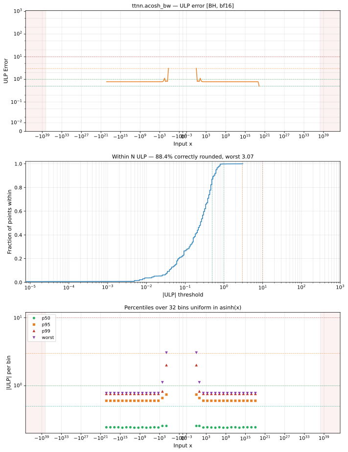

# acosh_bw — Blackhole (BH), bfloat16
_This page is auto-generated by `ttnn-accuracy report`. Do not edit manually._

**Architecture:** Blackhole (BH)  
**Data type:** bfloat16  

---

[← Blackhole (BH) bfloat16 ops](README.md) | [All archs for acosh_bw](../../../by_op/acosh_bw/README.md) | [Top](../../../README.md)

**Measured input range:** x ∈ [-8.507e+37, 8.507e+37]  

|  | `default` |
|---|---|
| Max ULP | 3.07 |
| Min ULP | 0 |
| Mean ULP | 0.64 |
| Signed bias (ULP) | 0.277 |
| p50 ULP | 0.246 |
| p95 ULP | 0.624 |
| p99 ULP | 0.782 |
| Exact fraction | 0.884 |
| Correctly rounded | 0.884 |
| Accurate to \|x\| | 1.03 |
| Max abs error | 0.048 |
| Max rel error | 0.0161 |
| Median rel error | 0.0033 |
| Bits of precision (worst) | 5.96 |
| Bits of precision (median) | 8.25 |

**default** — 15874/64514 defects; rest 3.07 ULP  

**Outcomes**

| Parameters | exact | faithful | inexact | mismatch | zeroed |
|---|---|---|---|---|---|
| `default` | 14,486 | 1,870 | 26 | 32,258 | 15,874 |

**Worst points**

| Parameters | x | golden | device | ULP |
|---|---|---|---|---|
| `default` | 1.0546875 | 2.984375 | 3.03125 | 3.07 |
| `default` | -1.0546875 | 2.984375 | 3.03125 | 3.07 |
| `default` | 1.0625 | 2.78125 | 2.828125 | 2.74 |
| `default` | -1.0625 | 2.78125 | 2.828125 | 2.74 |
| `default` | 1.046875 | 3.234375 | 3.265625 | 2.38 |
| `default` | -1.046875 | 3.234375 | 3.265625 | 2.38 |
| `default` | 1.0390625 | 3.546875 | 3.578125 | 2.23 |
| `default` | -1.0390625 | 3.546875 | 3.578125 | 2.23 |
| `default` | 1.03125 | 3.96875 | 4 | 1.98 |
| `default` | -1.03125 | 3.96875 | 4 | 1.98 |

**Monotonicity**

_Checked only where the reference is itself ordered, and never across a discontinuity._

| Parameters | Pairs | Violations | Rate | Worst \|Δy\| |
|---|---|---|---|---|
| `default` | 16,380 | 0 | 0 | 0 |

**Non-finite outputs**

| Parameters | Points | Both | Device only | Golden only | Device inf | Device nan | Golden inf | Golden nan |
|---|---|---|---|---|---|---|---|---|
| `default` | 32,258 | 0 | 0 | 32,258 | 0 | 0 | 2 | 32,256 |

| Parameters | x | golden | device |
|---|---|---|---|
| `default` | 1.1754944e-38 | nan | 7.003998e+19 |
| `default` | 1.1846779e-38 | nan | 7.003998e+19 |
| `default` | 1.1938615e-38 | nan | 7.003998e+19 |
| `default` | 1.203045e-38 | nan | 7.003998e+19 |
| `default` | 1.2122285e-38 | nan | 7.003998e+19 |
| `default` | 1.2214121e-38 | nan | 7.003998e+19 |
| `default` | 1.2305956e-38 | nan | 7.003998e+19 |
| `default` | 1.2397792e-38 | nan | 7.003998e+19 |
| `default` | 1.2489627e-38 | nan | 7.003998e+19 |
| `default` | 1.2581463e-38 | nan | 7.003998e+19 |

### Special values

| Variant | x | device | golden |  |
|---|---|---|---|---|
| `default` | 0 | 7.003998e+19 | nan | **differ** |
| `default` | -0 | 7.003998e+19 | nan | **differ** |
| `default` | inf | 0 | 0 | agree |
| `default` | -inf | 0 | 0 | agree |
| `default` | nan | 0 | nan | **differ** |
| `default` | 1.1754944e-38 | 7.003998e+19 | nan | **differ** |
| `default` | -1.1754944e-38 | 7.003998e+19 | nan | **differ** |

_Measured on BLACKHOLE · tt-metal `978f93b56e3` · ttnn `0.80.0` · run `20261017T025102`_

