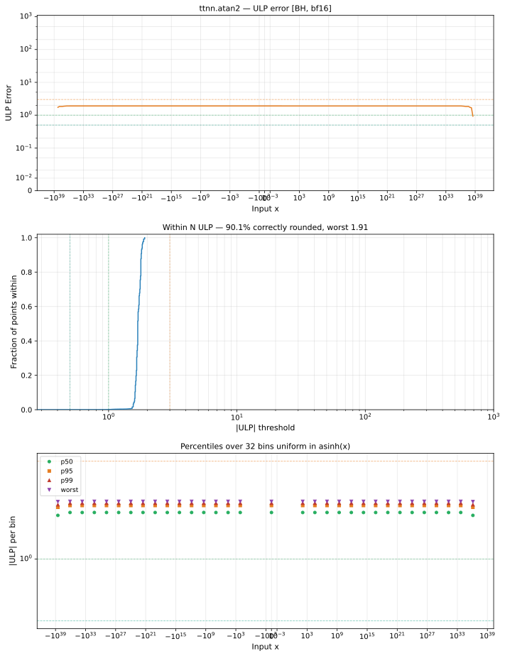

# atan2 — Blackhole (BH), bfloat16
_This page is auto-generated by `ttnn-accuracy report`. Do not edit manually._

**Architecture:** Blackhole (BH)  
**Data type:** bfloat16  

---

[← Blackhole (BH) bfloat16 ops](README.md) | [All archs for atan2](../../../by_op/atan2/README.md) | [Top](../../../README.md)

**Measured input range:** all normal values  

|  | `default` |
|---|---|
| Max ULP | 1.91 |
| Min ULP | 0.204 |
| Mean ULP | 1.7 |
| Signed bias (ULP) | 0 |
| p50 ULP | 1.69 |
| p95 ULP | 1.82 |
| p99 ULP | 1.87 |
| Exact fraction | 3.08e-05 |
| Correctly rounded | 0.901 |
| Max abs error | 0.0089 |
| Max rel error | 0.00802 |
| Median rel error | 0.00706 |
| Bits of precision (worst) | 6.96 |
| Bits of precision (median) | 7.15 |

**default** — within 2 ULP  

**Outcomes**

| Parameters | exact | faithful | inexact |
|---|---|---|---|
| `default` | 2 | 78 | 64,946 |

**Worst points**

| Parameters | x | x2 | golden | device | ULP |
|---|---|---|---|---|---|
| `default` | 2.2316026e-38 | 9.2158757e-35 | 0.00024223328 | 0.00024032593 | 1.91 |
| `default` | 4.463205e-38 | 1.8431751e-34 | 0.00024223328 | 0.00024032593 | 1.91 |
| `default` | 8.92641e-38 | 3.6863503e-34 | 0.00024223328 | 0.00024032593 | 1.91 |
| `default` | 1.785282e-37 | 7.3727006e-34 | 0.00024223328 | 0.00024032593 | 1.91 |
| `default` | 3.570564e-37 | 1.4745401e-33 | 0.00024223328 | 0.00024032593 | 1.91 |
| `default` | 7.141128e-37 | 2.9490802e-33 | 0.00024223328 | 0.00024032593 | 1.91 |
| `default` | 1.4282256e-36 | 5.8981605e-33 | 0.00024223328 | 0.00024032593 | 1.91 |
| `default` | 2.8564513e-36 | 1.1796321e-32 | 0.00024223328 | 0.00024032593 | 1.91 |
| `default` | 5.7129025e-36 | 2.3592642e-32 | 0.00024223328 | 0.00024032593 | 1.91 |
| `default` | 1.1425805e-35 | 4.7185284e-32 | 0.00024223328 | 0.00024032593 | 1.91 |

### Special values

| Variant | x | device | golden |  |
|---|---|---|---|---|
| `default` | 0 | 0 | 0 | agree |
| `default` | -0 | 0 | -0 | **differ** |
| `default` | inf | 1.5703125 | 1.5703125 | agree |
| `default` | -inf | -1.5703125 | -1.5703125 | agree |
| `default` | nan | inf | nan | **differ** |
| `default` | 1.1754944e-38 | 0 | 1.1754944e-38 | **differ** |
| `default` | -1.1754944e-38 | 0 | -1.1754944e-38 | **differ** |

_Measured on BLACKHOLE · tt-metal `bfc3f70fd49` · ttnn `0.82.0` · run `20261128T024243`_

