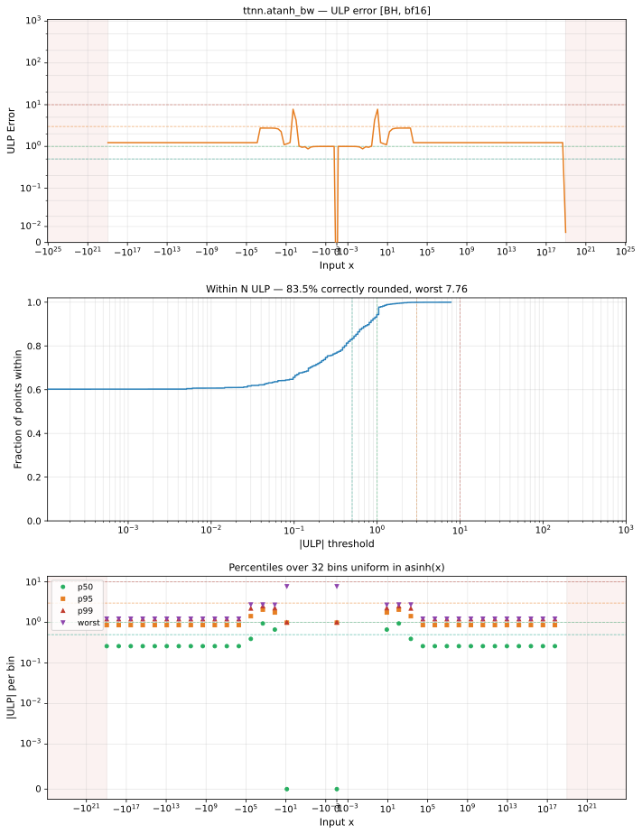

# atanh_bw — Blackhole (BH), bfloat16
_This page is auto-generated by `ttnn-accuracy report`. Do not edit manually._

**Architecture:** Blackhole (BH)  
**Data type:** bfloat16  

---

[← Blackhole (BH) bfloat16 ops](README.md) | [All archs for atanh_bw](../../../by_op/atanh_bw/README.md) | [Top](../../../README.md)

**Measured input range:** x ∈ [-9.223e+18, 9.223e+18]  

|  | `default` |
|---|---|
| Max ULP | 7.76 |
| Min ULP | 0 |
| Mean ULP | 0.885 |
| Signed bias (ULP) | -0.125 |
| p50 ULP | 0 |
| p95 ULP | 0.998 |
| p99 ULP | 1.37 |
| Exact fraction | 0.835 |
| Correctly rounded | 0.835 |
| Accurate to \|x\| | 0.918 |
| Max abs error | 0.289 |
| Max rel error | 0.0312 |
| Median rel error | 0.00495 |
| Bits of precision (worst) | 5 |
| Bits of precision (median) | 7.66 |

**default** — 2/48386 defects; rest 7.76 ULP  

**Outcomes**

| Parameters | exact | faithful | inexact | overflow | zeroed |
|---|---|---|---|---|---|
| `default` | 40,394 | 6,568 | 1,420 | 2 | 2 |

**Worst points**

| Parameters | x | golden | device | ULP |
|---|---|---|---|---|
| `default` | 1.0625 | -7.75 | -8 | 7.76 |
| `default` | -1.0625 | -7.75 | -8 | 7.76 |
| `default` | 0.95703125 | 11.875 | 11.625 | 4.27 |
| `default` | -0.95703125 | 11.875 | 11.625 | 4.27 |
| `default` | 1.046875 | -10.4375 | -10.6875 | 4.24 |
| `default` | -1.046875 | -10.4375 | -10.6875 | 4.24 |
| `default` | 1.0390625 | -12.5625 | -12.8125 | 4.12 |
| `default` | -1.0390625 | -12.5625 | -12.8125 | 4.12 |
| `default` | 1.03125 | -15.75 | -16 | 3.94 |
| `default` | -1.03125 | -15.75 | -16 | 3.94 |

**Non-finite outputs**

| Parameters | Points | Both | Device only | Golden only | Device inf | Device nan | Golden inf | Golden nan |
|---|---|---|---|---|---|---|---|---|
| `default` | 2 | 2 | 0 | 0 | 2 | 0 | 2 | 0 |

| Parameters | x | golden | device |
|---|---|---|---|
| `default` | 1 | inf | inf |
| `default` | -1 | inf | inf |

### Special values

| Variant | x | device | golden |  |
|---|---|---|---|---|
| `default` | 0 | 1 | 1 | agree |
| `default` | -0 | 1 | 1 | agree |
| `default` | inf | 0 | -0 | **differ** |
| `default` | -inf | 0 | -0 | **differ** |
| `default` | nan | 0 | nan | **differ** |
| `default` | 1.1754944e-38 | 1 | 1 | agree |
| `default` | -1.1754944e-38 | 1 | 1 | agree |

> **Provenance unknown.** These figures predate run tracking. Re-measure to attribute them.

