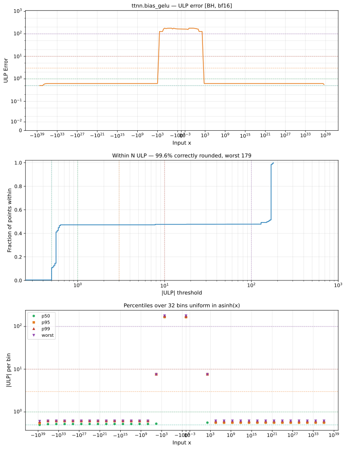

# bias_gelu — Blackhole (BH), bfloat16
_This page is auto-generated by `ttnn-accuracy report`. Do not edit manually._

**Architecture:** Blackhole (BH)  
**Data type:** bfloat16  

---

[← Blackhole (BH) bfloat16 ops](README.md) | [All archs for bias_gelu](../../../by_op/bias_gelu/README.md) | [Top](../../../README.md)

**Measured input range:** all normal values  

|  | `default` |
|---|---|
| Max ULP | 179 |
| Min ULP | 0 |
| Mean ULP | 86.3 |
| Signed bias (ULP) | 85.8 |
| p50 ULP | 153 |
| p95 ULP | 165 |
| p99 ULP | 173 |
| Exact fraction | 0.00394 |
| Correctly rounded | 0.996 |
| Max abs error | 7.48e+35 |
| Max rel error | 1.02 |
| Median rel error | 0.777 |
| Bits of precision (worst) | -0.0311 |
| Bits of precision (median) | 0.365 |

**default** — worst sampled pairing  

**Outcomes**

| Parameters | exact | faithful | inexact | mismatch | overflow |
|---|---|---|---|---|---|
| `default` | 256 | 30,463 | 34,305 | 1 | 1 |

**Worst points**

| Parameters | x | x2 | golden | device | ULP |
|---|---|---|---|---|---|
| `default` | 0.017578125 | -5.5625 | -8.1490725e-08 | -1.648441e-07 | 179 |
| `default` | 0.048828125 | -5.59375 | -8.1490725e-08 | -1.648441e-07 | 179 |
| `default` | 0.080078125 | -5.625 | -8.1490725e-08 | -1.648441e-07 | 179 |
| `default` | 0.111328125 | -5.65625 | -8.1490725e-08 | -1.648441e-07 | 179 |
| `default` | 0.14257812 | -5.6875 | -8.1490725e-08 | -1.648441e-07 | 179 |
| `default` | 0.17382812 | -5.71875 | -8.1490725e-08 | -1.648441e-07 | 179 |
| `default` | 0.20507812 | -5.75 | -8.1490725e-08 | -1.648441e-07 | 179 |
| `default` | 0.23632812 | -5.78125 | -8.1490725e-08 | -1.648441e-07 | 179 |
| `default` | 0.26757812 | -5.8125 | -8.1490725e-08 | -1.648441e-07 | 179 |
| `default` | 0.29882812 | -5.84375 | -8.1490725e-08 | -1.648441e-07 | 179 |

**Non-finite outputs**

| Parameters | Points | Both | Device only | Golden only | Device inf | Device nan | Golden inf | Golden nan |
|---|---|---|---|---|---|---|---|---|
| `default` | 2 | 1 | 0 | 1 | 1 | 0 | 1 | 1 |

| Parameters | x | x2 | golden | device |
|---|---|---|---|---|
| `default` | inf | 0 | inf | inf |
| `default` | -inf | 0 | nan | 0 |

### Special values

| Variant | x | device | golden |  |
|---|---|---|---|---|
| `default` | 0 | 0.83984375 | 0.83984375 | agree |
| `default` | -0 | 0.83984375 | 0.83984375 | agree |
| `default` | inf | inf | inf | agree |
| `default` | -inf | 0 | nan | **differ** |
| `default` | nan | inf | nan | **differ** |
| `default` | 1.1754944e-38 | 0.83984375 | 0.83984375 | agree |
| `default` | -1.1754944e-38 | 0.83984375 | 0.83984375 | agree |

> **Provenance unknown.** These figures predate run tracking. Re-measure to attribute them.

