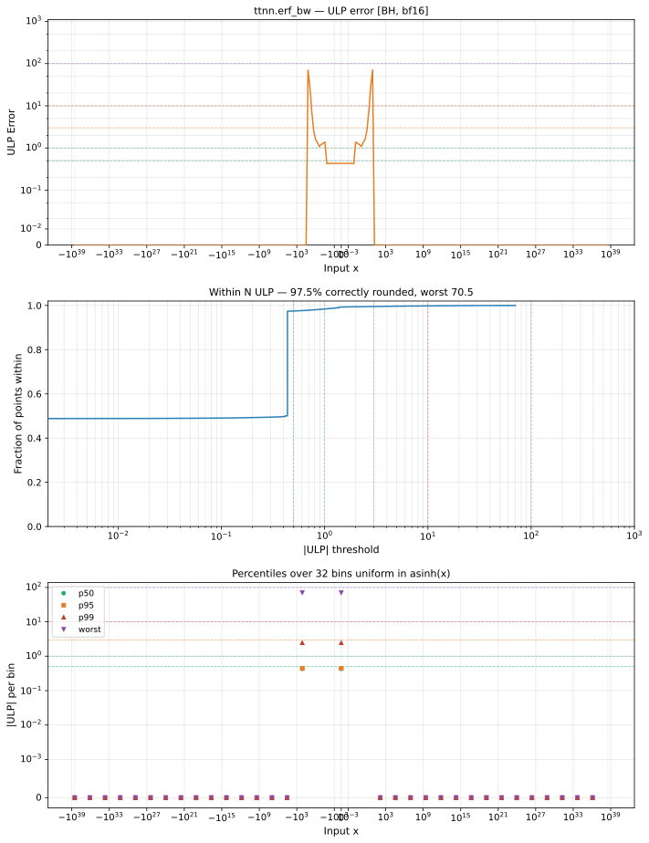

# erf_bw — Blackhole (BH), bfloat16
_This page is auto-generated by `ttnn-accuracy report`. Do not edit manually._

**Architecture:** Blackhole (BH)  
**Data type:** bfloat16  

---

[← Blackhole (BH) bfloat16 ops](README.md) | [All archs for erf_bw](../../../by_op/erf_bw/README.md) | [Top](../../../README.md)

**Measured input range:** x ∈ [-3.39e+38, 3.39e+38]  

|  | `default` |
|---|---|
| Max ULP | 70.5 |
| Min ULP | 0 |
| Mean ULP | 3.04 |
| Signed bias (ULP) | 0.839 |
| p50 ULP | 0.413 |
| p95 ULP | 0.433 |
| p99 ULP | 1.31 |
| Exact fraction | 0.975 |
| Correctly rounded | 0.975 |
| Accurate to \|x\| | 1.38 |
| Max abs error | 0.0108 |
| Max rel error | 0.287 |
| Median rel error | 0.00782 |
| Bits of precision (worst) | 1.8 |
| Bits of precision (median) | 7 |

**default** — accurate to |x| <= 1.38  

**Outcomes**

| Parameters | exact | faithful | flushed | inexact |
|---|---|---|---|---|
| `default` | 63,020 | 600 | 394 | 1,010 |

**Worst points**

| Parameters | x | golden | device | ULP |
|---|---|---|---|---|
| `default` | 8.5 | 4.7185284e-32 | 6.0859386e-32 | 70.5 |
| `default` | -8.5 | 4.7185284e-32 | 6.0859386e-32 | 70.5 |
| `default` | 8.875 | 6.9965424e-35 | 5.5295254e-35 | 39 |
| `default` | -8.875 | 6.9965424e-35 | 5.5295254e-35 | 39 |
| `default` | 8.4375 | 1.3635584e-31 | 1.648596e-31 | 37.1 |
| `default` | -8.4375 | 1.3635584e-31 | 1.648596e-31 | 37.1 |
| `default` | 8.375 | 3.8980822e-31 | 4.4681575e-31 | 37 |
| `default` | -8.375 | 3.8980822e-31 | 4.4681575e-31 | 37 |
| `default` | 9.3125 | 2.4428242e-38 | 3.0489385e-38 | 32.6 |
| `default` | -9.3125 | 2.4428242e-38 | 3.0489385e-38 | 32.6 |

**Monotonicity**

_Checked only where the reference is itself ordered, and never across a discontinuity._

| Parameters | Pairs | Violations | Rate | Worst \|Δy\| |
|---|---|---|---|---|
| `default` | 64,626 | 0 | 0 | 0 |

### Special values

| Variant | x | device | golden |  |
|---|---|---|---|---|
| `default` | 0 | 1.125 | 1.125 | agree |
| `default` | -0 | 1.125 | 1.125 | agree |
| `default` | inf | 0 | 0 | agree |
| `default` | -inf | 0 | 0 | agree |
| `default` | nan | inf | nan | **differ** |
| `default` | 1.1754944e-38 | 1.125 | 1.125 | agree |
| `default` | -1.1754944e-38 | 1.125 | 1.125 | agree |

_Measured on BLACKHOLE · tt-metal `978f93b56e3` · ttnn `0.80.0` · run `20261017T025102`_

