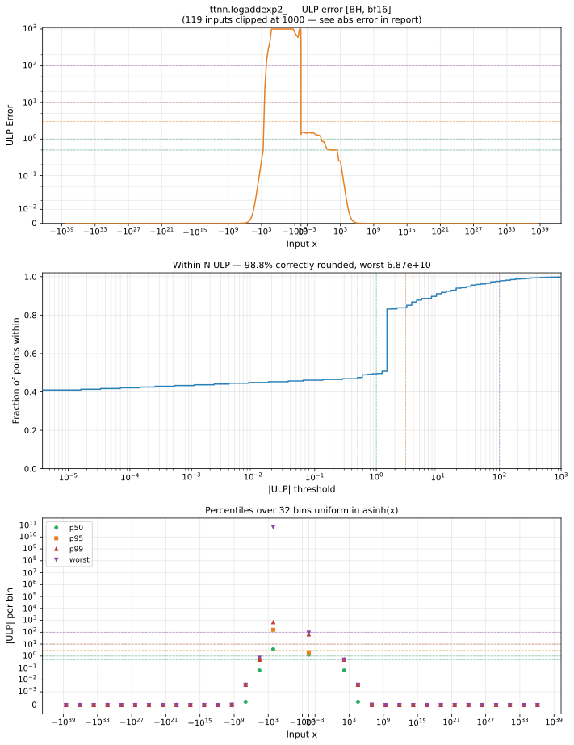

# logaddexp2_ — Blackhole (BH), bfloat16
_This page is auto-generated by `ttnn-accuracy report`. Do not edit manually._

**Architecture:** Blackhole (BH)  
**Data type:** bfloat16  

---

[← Blackhole (BH) bfloat16 ops](README.md) | [All archs for logaddexp2_](../../../by_op/logaddexp2_/README.md) | [Top](../../../README.md)

**Measured input range:** all normal values  

|  | `default` |
|---|---|
| Max ULP | 6.87e+10 ⚠ |
| Min ULP | 0 |
| Mean ULP | 2.05e+06 |
| Signed bias (ULP) | 2.05e+06 |
| p50 ULP | 1.19 |
| p95 ULP | 32.6 |
| p99 ULP | 231 |
| Exact fraction | 0.484 |
| Correctly rounded | 0.988 |
| Max abs error | 1 |
| Max rel error | 3.13e+08 |
| Median rel error | 0.00653 |
| Bits of precision (worst) | -28.2 |
| Bits of precision (median) | 7.26 |

**default** — worst sampled pairing  

**Outcomes**

| Parameters | exact | faithful | inexact | overflow |
|---|---|---|---|---|
| `default` | 31,458 | 730 | 32,837 | 1 |

**Worst points**

| Parameters | x | x2 | golden | device | ULP |
|---|---|---|---|---|---|
| `default` | -1 | -1 | -4.7488055e-17 | -1.4901161e-08 | 6.87e+10 |
| `default` | -0.015014648 | -6.59375 | 2.7706847e-08 | -3.361702e-05 | 2.89e+05 |
| `default` | -6.59375 | -0.015014648 | 2.7706847e-08 | -3.361702e-05 | 2.89e+05 |
| `default` | -0.75390625 | -1.296875 | 3.799796e-06 | 0.0009536743 | 6.37e+04 |
| `default` | -1.296875 | -0.75390625 | 3.799796e-06 | 0.0009536743 | 6.37e+04 |
| `default` | -0.0027008057 | -9.0625 | 2.0605512e-08 | 4.4107437e-06 | 3.77e+04 |
| `default` | -9.0625 | -0.0027008057 | 2.0605512e-08 | 4.4107437e-06 | 3.77e+04 |
| `default` | -0.19042969 | -3.015625 | -2.6375055e-06 | -0.00050735474 | 3.39e+04 |
| `default` | -3.015625 | -0.19042969 | -2.6375055e-06 | -0.00050735474 | 3.39e+04 |
| `default` | -0.26757812 | -2.5625 | -7.4207783e-06 | 0.00046920776 | 1.6e+04 |

**Non-finite outputs**

| Parameters | Points | Both | Device only | Golden only | Device inf | Device nan | Golden inf | Golden nan |
|---|---|---|---|---|---|---|---|---|
| `default` | 1 | 1 | 0 | 0 | 1 | 0 | 1 | 0 |

| Parameters | x | x2 | golden | device |
|---|---|---|---|---|
| `default` | inf | 0 | inf | inf |

### Special values

| Variant | x | device | golden |  |
|---|---|---|---|---|
| `default` | 0 | 1.5859375 | 1.5859375 | agree |
| `default` | -0 | 1.5859375 | 1.5859375 | agree |
| `default` | inf | inf | inf | agree |
| `default` | -inf | 1 | 1 | agree |
| `default` | nan | inf | nan | **differ** |
| `default` | 1.1754944e-38 | 1.5859375 | 1.5859375 | agree |
| `default` | -1.1754944e-38 | 1.5859375 | 1.5859375 | agree |

> **Provenance unknown.** These figures predate run tracking. Re-measure to attribute them.

