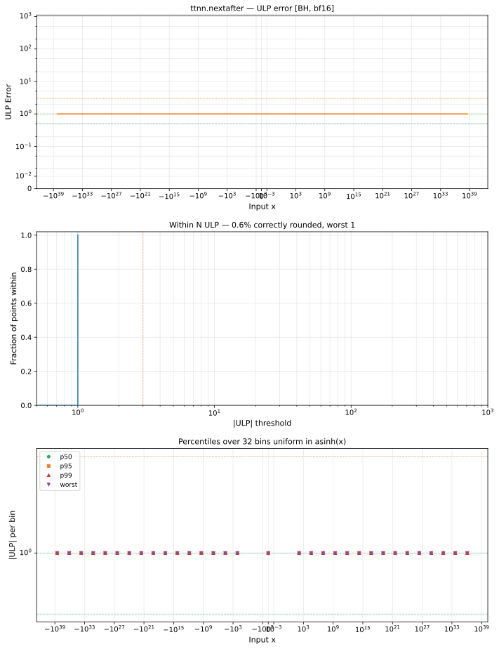

# nextafter — Blackhole (BH), bfloat16
_This page is auto-generated by `ttnn-accuracy report`. Do not edit manually._

**Architecture:** Blackhole (BH)  
**Data type:** bfloat16  

---

[← Blackhole (BH) bfloat16 ops](README.md) | [All archs for nextafter](../../../by_op/nextafter/README.md) | [Top](../../../README.md)

**Measured input range:** all normal values  

|  | `default` |
|---|---|
| Max ULP | 1 |
| Min ULP | 1 |
| Mean ULP | 1 |
| Signed bias (ULP) | 0 |
| p50 ULP | 1 |
| p95 ULP | 1 |
| p99 ULP | 1 |
| Exact fraction | 0 |
| Correctly rounded | 0.00585 |
| Max abs error | 1.33e+36 |
| Max rel error | 0.00781 |
| Median rel error | 0.00522 |
| Bits of precision (worst) | 7 |
| Bits of precision (median) | 7.58 |

**default** — within 2 ULP  

**Outcomes**

| Parameters | inexact | mismatch |
|---|---|---|
| `default` | 65,024 | 2 |

**Worst points**

| Parameters | x | x2 | golden | device | ULP |
|---|---|---|---|---|---|
| `default` | 1.1754944e-38 | 1.1846779e-38 | 1.1754944e-38 | 1.1846779e-38 | 1 |
| `default` | 1.1846779e-38 | 0 | 1.1846779e-38 | 1.1754944e-38 | 1 |
| `default` | 1.1938615e-38 | 0 | 1.1938615e-38 | 1.1846779e-38 | 1 |
| `default` | 1.203045e-38 | 0 | 1.203045e-38 | 1.1938615e-38 | 1 |
| `default` | 1.2122285e-38 | 0 | 1.2122285e-38 | 1.203045e-38 | 1 |
| `default` | 1.2214121e-38 | 0 | 1.2214121e-38 | 1.2122285e-38 | 1 |
| `default` | 1.2305956e-38 | 0 | 1.2305956e-38 | 1.2214121e-38 | 1 |
| `default` | 1.2397792e-38 | 0 | 1.2397792e-38 | 1.2305956e-38 | 1 |
| `default` | 1.2489627e-38 | 0 | 1.2489627e-38 | 1.2397792e-38 | 1 |
| `default` | 1.2581463e-38 | 0 | 1.2581463e-38 | 1.2489627e-38 | 1 |

**Non-finite outputs**

| Parameters | Points | Both | Device only | Golden only | Device inf | Device nan | Golden inf | Golden nan |
|---|---|---|---|---|---|---|---|---|
| `default` | 2 | 0 | 0 | 2 | 0 | 0 | 2 | 0 |

| Parameters | x | x2 | golden | device |
|---|---|---|---|---|
| `default` | inf | 0 | inf | 3.3895314e+38 |
| `default` | -inf | 0 | -inf | -3.3895314e+38 |

### Special values

| Variant | x | device | golden |  |
|---|---|---|---|---|
| `default` | 0 | 0 | 0 | agree |
| `default` | -0 | 0 | 0 | agree |
| `default` | inf | 3.3895314e+38 | inf | **differ** |
| `default` | -inf | -3.3895314e+38 | -inf | **differ** |
| `default` | nan | inf | nan | **differ** |
| `default` | 1.1754944e-38 | 1.1846779e-38 | 1.1754944e-38 | **differ** |
| `default` | -1.1754944e-38 | 0 | -1.1754944e-38 | **differ** |

_Measured on BLACKHOLE · tt-metal `978f93b56e3` · ttnn `0.80.0` · run `20261017T025047`_

