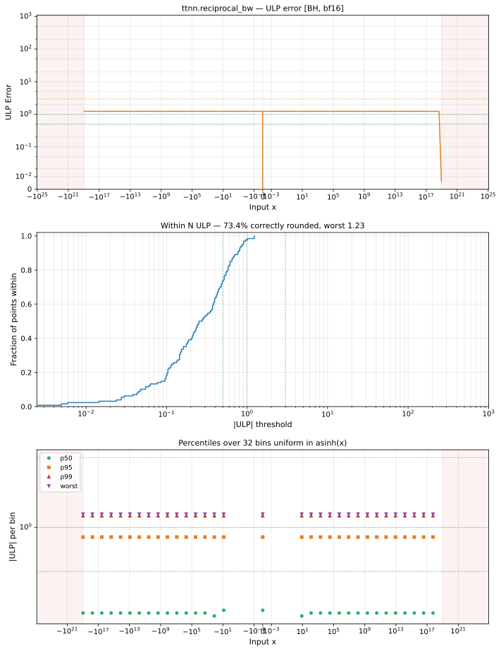

# reciprocal_bw — Blackhole (BH), bfloat16
_This page is auto-generated by `ttnn-accuracy report`. Do not edit manually._

**Architecture:** Blackhole (BH)  
**Data type:** bfloat16  

---

[← Blackhole (BH) bfloat16 ops](README.md) | [All archs for reciprocal_bw](../../../by_op/reciprocal_bw/README.md) | [Top](../../../README.md)

**Measured input range:** x ∈ [-9.223e+18, 9.223e+18]  

|  | `default` |
|---|---|
| Max ULP | 1.23 |
| Min ULP | 0 |
| Mean ULP | 0.714 |
| Signed bias (ULP) | -0.159 |
| p50 ULP | 0.26 |
| p95 ULP | 0.86 |
| p99 ULP | 1.2 |
| Exact fraction | 0.734 |
| Correctly rounded | 0.734 |
| Accurate to \|x\| | 5.42e-20 |
| Max abs error | 4.09e+35 |
| Max rel error | 0.00547 |
| Median rel error | 0.0038 |
| Bits of precision (worst) | 7.51 |
| Bits of precision (median) | 8.04 |

**default** — 256/48386 defects; rest 1.23 ULP  

**Outcomes**

| Parameters | exact | faithful | inexact | mismatch | overflow | zeroed |
|---|---|---|---|---|---|---|
| `default` | 23,688 | 7,812 | 756 | 254 | 15,874 | 2 |

**Worst points**

| Parameters | x | golden | device | ULP |
|---|---|---|---|---|
| `default` | 1.1519648e-19 | -7.543369e+37 | -7.5765996e+37 | 1.23 |
| `default` | 2.3039296e-19 | -1.8858422e+37 | -1.8941499e+37 | 1.23 |
| `default` | 4.607859e-19 | -4.7146055e+36 | -4.7353747e+36 | 1.23 |
| `default` | 9.215718e-19 | -1.1786514e+36 | -1.1838437e+36 | 1.23 |
| `default` | 1.8431437e-18 | -2.9466285e+35 | -2.9596092e+35 | 1.23 |
| `default` | 3.6862874e-18 | -7.366571e+34 | -7.399023e+34 | 1.23 |
| `default` | 7.372575e-18 | -1.8416428e+34 | -1.8497558e+34 | 1.23 |
| `default` | 1.474515e-17 | -4.604107e+33 | -4.6243894e+33 | 1.23 |
| `default` | 2.94903e-17 | -1.15102675e+33 | -1.15609735e+33 | 1.23 |
| `default` | 5.89806e-17 | -2.8775669e+32 | -2.8902434e+32 | 1.23 |

**Monotonicity**

_Checked only where the reference is itself ordered, and never across a discontinuity._

| Parameters | Pairs | Violations | Rate | Worst \|Δy\| |
|---|---|---|---|---|
| `default` | 32,254 | 0 | 0 | 0 |

**Non-finite outputs**

| Parameters | Points | Both | Device only | Golden only | Device inf | Device nan | Golden inf | Golden nan |
|---|---|---|---|---|---|---|---|---|
| `default` | 16,128 | 15,874 | 254 | 0 | 16,128 | 0 | 15,874 | 0 |

| Parameters | x | golden | device |
|---|---|---|---|
| `default` | 1.1754944e-38 | -inf | -inf |
| `default` | 1.1846779e-38 | -inf | -inf |
| `default` | 1.1938615e-38 | -inf | -inf |
| `default` | 1.203045e-38 | -inf | -inf |
| `default` | 1.2122285e-38 | -inf | -inf |
| `default` | 1.2214121e-38 | -inf | -inf |
| `default` | 1.2305956e-38 | -inf | -inf |
| `default` | 1.2397792e-38 | -inf | -inf |
| `default` | 1.2489627e-38 | -inf | -inf |
| `default` | 1.2581463e-38 | -inf | -inf |

### Special values

| Variant | x | device | golden |  |
|---|---|---|---|---|
| `default` | 0 | -inf | -inf | agree |
| `default` | -0 | -inf | -inf | agree |
| `default` | inf | 0 | -0 | **differ** |
| `default` | -inf | 0 | -0 | **differ** |
| `default` | nan | 0 | nan | **differ** |
| `default` | 1.1754944e-38 | -inf | -inf | agree |
| `default` | -1.1754944e-38 | -inf | -inf | agree |

_Measured on BLACKHOLE · tt-metal `d80d9482a41` · ttnn `0.81.1` · run `20261031T024244`_

