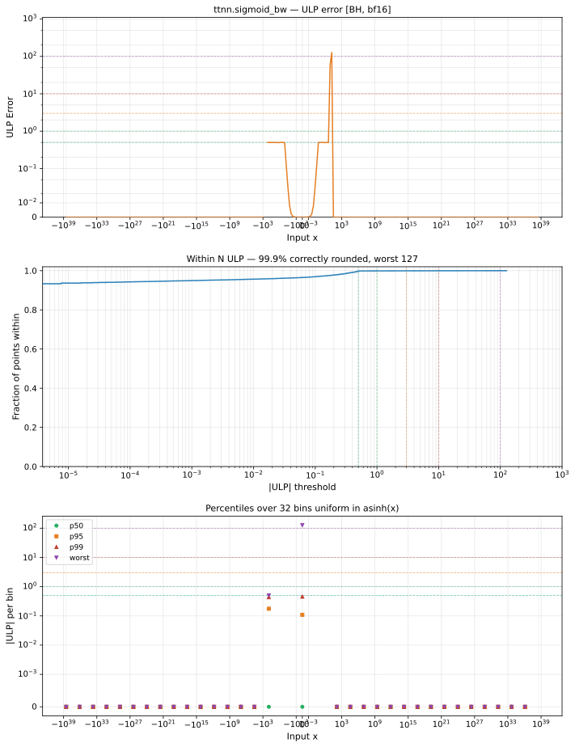

# sigmoid_bw — Blackhole (BH), bfloat16
_This page is auto-generated by `ttnn-accuracy report`. Do not edit manually._

**Architecture:** Blackhole (BH)  
**Data type:** bfloat16  

---

[← Blackhole (BH) bfloat16 ops](README.md) | [All archs for sigmoid_bw](../../../by_op/sigmoid_bw/README.md) | [Top](../../../README.md)

**Measured input range:** x ∈ [-3.39e+38, 3.39e+38]  

|  | `default` |
|---|---|
| Max ULP | 127 |
| Min ULP | 0 |
| Mean ULP | 12.7 |
| Signed bias (ULP) | -4.49 |
| p50 ULP | 0 |
| p95 ULP | 0.00123 |
| p99 ULP | 0.361 |
| Exact fraction | 0.999 |
| Correctly rounded | 0.999 |
| Accurate to \|x\| | 12.5 |
| Max abs error | 0.000488 |
| Max rel error | 0.979 |
| Median rel error | 0.0145 |
| Bits of precision (worst) | 0.0306 |
| Bits of precision (median) | 6.11 |

**default** — 141/65024 defects; rest 127 ULP  

**Outcomes**

| Parameters | exact | faithful | flushed | inexact | zeroed |
|---|---|---|---|---|---|
| `default` | 64,404 | 20 | 387 | 72 | 141 |

**Worst points**

| Parameters | x | golden | device | ULP |
|---|---|---|---|---|
| `default` | 16.625 | 6.0070306e-08 | 1.1920929e-07 | 127 |
| `default` | 16.5 | 6.845221e-08 | 1.1920929e-07 | 109 |
| `default` | 16.375 | 7.7299774e-08 | 1.1920929e-07 | 89.9 |
| `default` | 16.25 | 8.754432e-08 | 1.1920929e-07 | 67.8 |
| `default` | 15.5625 | 1.7415732e-07 | 1.1920929e-07 | 59.2 |
| `default` | 15.5 | 1.8533319e-07 | 2.3841858e-07 | 56.8 |
| `default` | 15.625 | 1.6391277e-07 | 1.1920929e-07 | 47.8 |
| `default` | 15.4375 | 1.9744039e-07 | 2.3841858e-07 | 43.9 |
| `default` | 16.125 | 9.9185854e-08 | 1.1920929e-07 | 42.7 |
| `default` | 15.6875 | 1.5366822e-07 | 1.1920929e-07 | 37.2 |

**Monotonicity**

_Checked only where the reference is itself ordered, and never across a discontinuity._

| Parameters | Pairs | Violations | Rate | Worst \|Δy\| |
|---|---|---|---|---|
| `default` | 64,492 | 0 | 0 | 0 |

### Special values

| Variant | x | device | golden |  |
|---|---|---|---|---|
| `default` | 0 | 0.25 | 0.25 | agree |
| `default` | -0 | 0.25 | 0.25 | agree |
| `default` | inf | 0 | 0 | agree |
| `default` | -inf | 0 | 0 | agree |
| `default` | nan | 0 | nan | **differ** |
| `default` | 1.1754944e-38 | 0.25 | 0.25 | agree |
| `default` | -1.1754944e-38 | 0.25 | 0.25 | agree |

_Measured on BLACKHOLE · tt-metal `978f93b56e3` · ttnn `0.80.0` · run `20261024T025259`_

