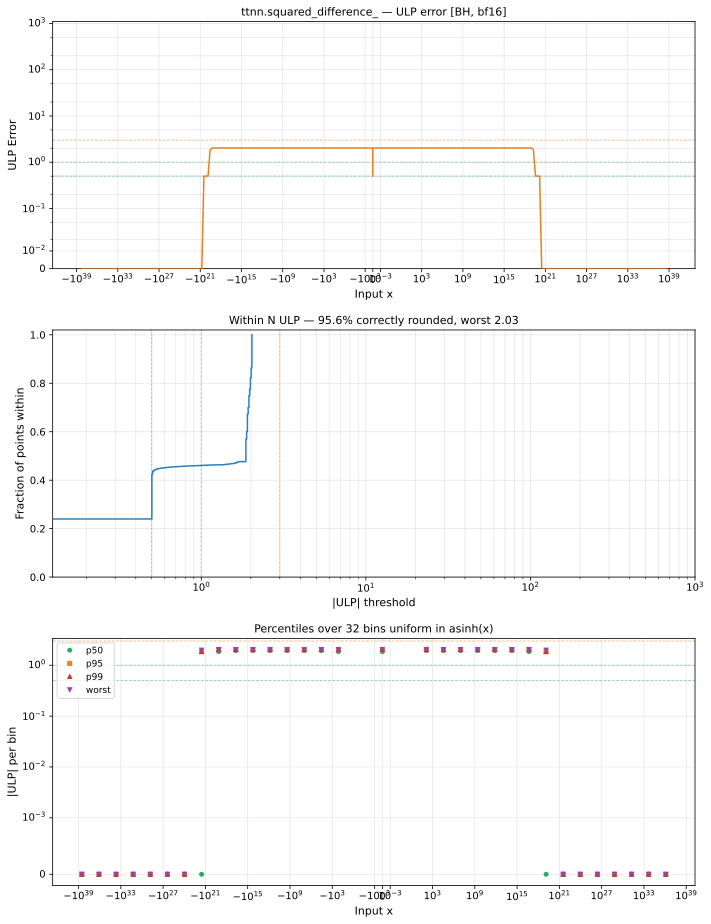

# squared_difference_ — Blackhole (BH), bfloat16
_This page is auto-generated by `ttnn-accuracy report`. Do not edit manually._

**Architecture:** Blackhole (BH)  
**Data type:** bfloat16  

---

[← Blackhole (BH) bfloat16 ops](README.md) | [All archs for squared_difference_](../../../by_op/squared_difference_/README.md) | [Top](../../../README.md)

**Measured input range:** all normal values  

|  | `default` |
|---|---|
| Max ULP | 2.03 |
| Min ULP | 0 |
| Mean ULP | 1.79 |
| Signed bias (ULP) | -1.67 |
| p50 ULP | 1.86 |
| p95 ULP | 2.03 |
| p99 ULP | 2.03 |
| Exact fraction | 0.398 |
| Correctly rounded | 0.956 |
| Max abs error | 1.85e+36 |
| Max rel error | 0.00962 |
| Median rel error | 0.0079 |
| Bits of precision (worst) | 6.7 |
| Bits of precision (median) | 6.98 |

**default** — worst sampled pairing  

**Outcomes**

| Parameters | exact | faithful | inexact | overflow |
|---|---|---|---|---|
| `default` | 25,864 | 4,106 | 35,054 | 2 |

**Worst points**

| Parameters | x | x2 | golden | device | ULP |
|---|---|---|---|---|---|
| `default` | 3.7057691e-22 | -1.4992483e-19 | 2.2591532e-38 | 2.2775203e-38 | 2.03 |
| `default` | 7.4115383e-22 | -2.9984966e-19 | 9.036613e-38 | 9.110081e-38 | 2.03 |
| `default` | 1.2176099e-21 | -1.490778e-19 | 2.2591532e-38 | 2.2775203e-38 | 2.03 |
| `default` | 1.4823077e-21 | -5.9969933e-19 | 3.6146451e-37 | 3.6440325e-37 | 2.03 |
| `default` | 2.0646428e-21 | -1.4823077e-19 | 2.2591532e-38 | 2.2775203e-38 | 2.03 |
| `default` | 2.4352197e-21 | -2.981556e-19 | 9.036613e-38 | 9.110081e-38 | 2.03 |
| `default` | 2.9116758e-21 | -1.4738373e-19 | 2.2591532e-38 | 2.2775203e-38 | 2.03 |
| `default` | 2.9646153e-21 | -1.1993987e-18 | 1.44585805e-36 | 1.457613e-36 | 2.03 |
| `default` | 3.7587087e-21 | -1.465367e-19 | 2.2591532e-38 | 2.2775203e-38 | 2.03 |
| `default` | 4.1292856e-21 | -2.9646153e-19 | 9.036613e-38 | 9.110081e-38 | 2.03 |

**Non-finite outputs**

| Parameters | Points | Both | Device only | Golden only | Device inf | Device nan | Golden inf | Golden nan |
|---|---|---|---|---|---|---|---|---|
| `default` | 2 | 2 | 0 | 0 | 2 | 0 | 2 | 0 |

| Parameters | x | x2 | golden | device |
|---|---|---|---|---|
| `default` | inf | 0 | inf | inf |
| `default` | -inf | 0 | inf | inf |

### Special values

| Variant | x | device | golden |  |
|---|---|---|---|---|
| `default` | 0 | 1 | 1 | agree |
| `default` | -0 | 1 | 1 | agree |
| `default` | inf | inf | inf | agree |
| `default` | -inf | inf | inf | agree |
| `default` | nan | inf | nan | **differ** |
| `default` | 1.1754944e-38 | 1 | 1 | agree |
| `default` | -1.1754944e-38 | 1 | 1 | agree |

_Measured on BLACKHOLE · tt-metal `978f93b56e3` · ttnn `0.80.0` · run `20261024T025310`_

