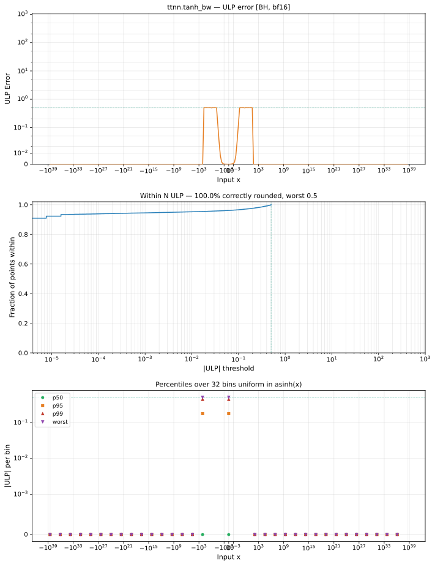

# tanh_bw — Blackhole (BH), bfloat16
_This page is auto-generated by `ttnn-accuracy report`. Do not edit manually._

**Architecture:** Blackhole (BH)  
**Data type:** bfloat16  

---

[← Blackhole (BH) bfloat16 ops](README.md) | [All archs for tanh_bw](../../../by_op/tanh_bw/README.md) | [Top](../../../README.md)

**Measured input range:** x ∈ [-3.39e+38, 3.39e+38]  

|  | `default` |
|---|---|
| Max ULP | 0.5 |
| Min ULP | 0 |
| Mean ULP | 0 |
| Signed bias (ULP) | 0 |
| p50 ULP | 0 |
| p95 ULP | 0.005 |
| p99 ULP | 0.364 |
| Exact fraction | 1 |
| Correctly rounded | 1 |
| Accurate to \|x\| | 3.39e+38 |
| Max abs error | 0.00195 |
| Max rel error | 0.00369 |
| Median rel error | 0 |
| Bits of precision (worst) | 8.08 |
| Bits of precision (median) | — |

**default** — bit-exact  

**Outcomes**

| Parameters | exact | flushed |
|---|---|---|
| `default` | 64,964 | 60 |

**Worst points**

| Parameters | x | golden | device | ULP |
|---|---|---|---|---|
| `default` | 1.890625 | 0.08691406 | 0.08691406 | 0.5 |
| `default` | -1.890625 | 0.08691406 | 0.08691406 | 0.5 |
| `default` | 9.9375 | 9.371433e-09 | 9.371433e-09 | 0.499 |
| `default` | -9.9375 | 9.371433e-09 | 9.371433e-09 | 0.499 |
| `default` | 0.48828125 | 0.796875 | 0.796875 | 0.499 |
| `default` | -0.48828125 | 0.796875 | 0.796875 | 0.499 |
| `default` | 0.17285156 | 0.97265625 | 0.97265625 | 0.499 |
| `default` | -0.17285156 | 0.97265625 | 0.97265625 | 0.499 |
| `default` | 0.099121094 | 0.9921875 | 0.9921875 | 0.499 |
| `default` | -0.099121094 | 0.9921875 | 0.9921875 | 0.499 |

**Monotonicity**

_Checked only where the reference is itself ordered, and never across a discontinuity._

| Parameters | Pairs | Violations | Rate | Worst \|Δy\| |
|---|---|---|---|---|
| `default` | 64,960 | 0 | 0 | 0 |

### Special values

| Variant | x | device | golden |  |
|---|---|---|---|---|
| `default` | 0 | 1 | 1 | agree |
| `default` | -0 | 1 | 1 | agree |
| `default` | inf | 0 | 0 | agree |
| `default` | -inf | 0 | 0 | agree |
| `default` | nan | 0 | nan | **differ** |
| `default` | 1.1754944e-38 | 1 | 1 | agree |
| `default` | -1.1754944e-38 | 1 | 1 | agree |

_Measured on BLACKHOLE · tt-metal `978f93b56e3` · ttnn `0.80.0` · run `20261024T025259`_

