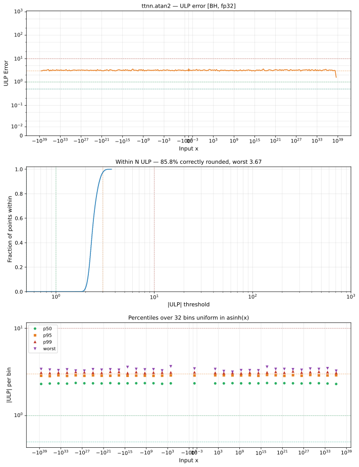

# atan2 — Blackhole (BH), float32
_This page is auto-generated by `ttnn-accuracy report`. Do not edit manually._

**Architecture:** Blackhole (BH)  
**Data type:** float32  

---

[← Blackhole (BH) float32 ops](README.md) | [All archs for atan2](../../../by_op/atan2/README.md) | [Top](../../../README.md)

**Measured input range:** all normal values  

|  | `default` |
|---|---|
| Max ULP | 3.67 |
| Min ULP | 1.53 |
| Mean ULP | 2.39 |
| Signed bias (ULP) | -0.00091 |
| p50 ULP | 2.34 |
| p95 ULP | 2.88 |
| p99 ULP | 3.12 |
| Exact fraction | 0 |
| Correctly rounded | 0.858 |
| Max abs error | 2.19e-07 |
| Max rel error | 2.76e-07 |
| Median rel error | 1.63e-07 |
| Bits of precision (worst) | 21.8 |
| Bits of precision (median) | 22.5 |

**default** — worst sampled pairing  

**Outcomes**

| Parameters | inexact |
|---|---|
| `default` | 65,024 |

**Worst points**

| Parameters | x | x2 | golden | device | ULP |
|---|---|---|---|---|---|
| `default` | -1.4988576e-33 | 1.4781162e-33 | -0.7923653 | -0.79236555 | 3.67 |
| `default` | 5.603848e+17 | 5.484378e+17 | 0.7961722 | 0.79617244 | 3.63 |
| `default` | -1.0568718e+12 | 1.0347742e+12 | -0.79596245 | -0.7959627 | 3.61 |
| `default` | 4.8078183e-14 | 4.7268972e-14 | 0.79388493 | 0.7938852 | 3.57 |
| `default` | 3.80778e-34 | 3.7452077e-34 | 0.7936824 | 0.79368263 | 3.55 |
| `default` | 6.646944e-12 | 6.534716e-12 | 0.7939119 | 0.7939121 | 3.51 |
| `default` | -4.397087e-38 | 4.2953424e-38 | -0.7971026 | -0.7971028 | 3.5 |
| `default` | 6.1853494e+35 | 6.0710006e+35 | 0.7947277 | 0.79472786 | 3.49 |
| `default` | -3.4120797e-15 | 3.340286e-15 | -0.79603016 | -0.79603034 | 3.49 |
| `default` | 0.0272415 | 0.02674005 | 0.7946872 | 0.7946874 | 3.46 |

### Special values

| Variant | x | device | golden |  |
|---|---|---|---|---|
| `default` | 0 | 0 | 0 | agree |
| `default` | -0 | -0 | -0 | agree |
| `default` | inf | 1.5707964 | 1.5707964 | agree |
| `default` | -inf | -1.5707964 | -1.5707964 | agree |
| `default` | nan | nan | nan | agree |
| `default` | 1.1754944e-38 | 1.1754944e-38 | 1.1754944e-38 | agree |
| `default` | -1.1754944e-38 | -1.1754944e-38 | -1.1754944e-38 | agree |

> **Sampled, not exhaustive.** For this op both operands take 65,536 of the 2³² fp32 values, drawn once from a fixed seed. The figures above are a lower bound on the error, and comparable between releases, but they are not a bound over the dtype.

_Measured on BLACKHOLE · tt-metal `bfc3f70fd49` · ttnn `0.82.0` · run `20261128T024243`_

