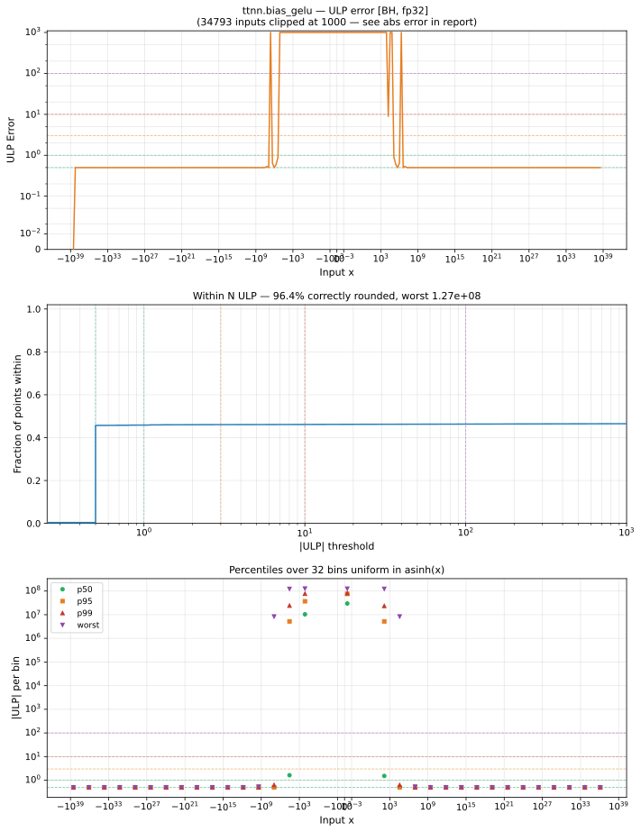

# bias_gelu — Blackhole (BH), float32
_This page is auto-generated by `ttnn-accuracy report`. Do not edit manually._

**Architecture:** Blackhole (BH)  
**Data type:** float32  

---

[← Blackhole (BH) float32 ops](README.md) | [All archs for bias_gelu](../../../by_op/bias_gelu/README.md) | [Top](../../../README.md)

**Measured input range:** all normal values  

|  | `default` |
|---|---|
| Max ULP | 1.27e+08 ⚠ |
| Min ULP | 0 |
| Mean ULP | 1.48e+07 |
| Signed bias (ULP) | 1.47e+07 |
| p50 ULP | 1.04e+07 |
| p95 ULP | 3.35e+07 |
| p99 ULP | 5.78e+07 |
| Exact fraction | 0.457 |
| Correctly rounded | 0.964 |
| Max abs error | 1.01e+31 |
| Max rel error | 10.5 |
| Median rel error | 0.811 |
| Bits of precision (worst) | -3.4 |
| Bits of precision (median) | 0.303 |

**default** — worst sampled pairing  

**Outcomes**

| Parameters | exact | faithful | inexact |
|---|---|---|---|
| `default` | 29,719 | 117 | 35,188 |

**Worst points**

| Parameters | x | x2 | golden | device | ULP |
|---|---|---|---|---|---|
| `default` | -2.6916971 | -2.8439937 | -8.580434e-08 | -9.898587e-07 | 1.27e+08 |
| `default` | -2.8439937 | -2.6916971 | -8.580434e-08 | -9.898587e-07 | 1.27e+08 |
| `default` | 1.3455161 | -6.864058 | -9.431848e-08 | -9.867922e-07 | 1.26e+08 |
| `default` | -6.864058 | 1.3455161 | -9.431848e-08 | -9.867922e-07 | 1.26e+08 |
| `default` | 0.03042598 | -5.544956 | -9.642509e-08 | -9.860748e-07 | 1.25e+08 |
| `default` | -5.544956 | 0.03042598 | -9.642509e-08 | -9.860748e-07 | 1.25e+08 |
| `default` | 0.0272415 | -5.525147 | -1.0565019e-07 | -9.83102e-07 | 1.23e+08 |
| `default` | -5.525147 | 0.0272415 | -1.0565019e-07 | -9.83102e-07 | 1.23e+08 |
| `default` | 164.97972 | -170.47585 | -1.06687736e-07 | -9.827836e-07 | 1.23e+08 |
| `default` | -170.47585 | 164.97972 | -1.06687736e-07 | -9.827836e-07 | 1.23e+08 |

### Special values

| Variant | x | device | golden |  |
|---|---|---|---|---|
| `default` | 0 | 0.8413447 | 0.8413448 | **differ** |
| `default` | -0 | 0.8413447 | 0.8413448 | **differ** |
| `default` | inf | inf | inf | agree |
| `default` | -inf | 0 | nan | **differ** |
| `default` | nan | nan | nan | agree |
| `default` | 1.1754944e-38 | 0.8413447 | 0.8413448 | **differ** |
| `default` | -1.1754944e-38 | 0.8413447 | 0.8413448 | **differ** |

> **Sampled, not exhaustive.** For this op both operands take 65,536 of the 2³² fp32 values, drawn once from a fixed seed. The figures above are a lower bound on the error, and comparable between releases, but they are not a bound over the dtype.

> **Provenance unknown.** These figures predate run tracking. Re-measure to attribute them.

