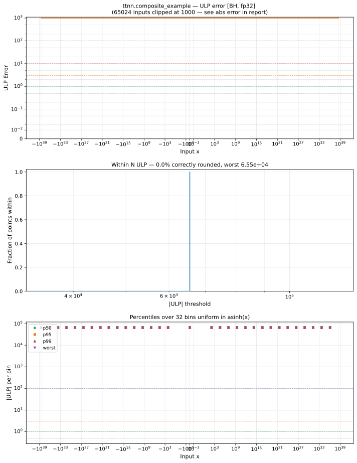

# composite_example — Blackhole (BH), float32
_This page is auto-generated by `ttnn-accuracy report`. Do not edit manually._

**Architecture:** Blackhole (BH)  
**Data type:** float32  

---

[← Blackhole (BH) float32 ops](README.md) | [All archs for composite_example](../../../by_op/composite_example/README.md) | [Top](../../../README.md)

**Measured input range:** x ∈ [-3.403e+38, 3.403e+38]  

|  | `default` |
|---|---|
| Max ULP | 6.55e+04 ⚠ |
| Min ULP | 6.55e+04 |
| Mean ULP | 6.55e+04 |
| Signed bias (ULP) | 0 |
| p50 ULP | 6.55e+04 |
| p95 ULP | 6.55e+04 |
| p99 ULP | 6.55e+04 |
| Exact fraction | 0 |
| Correctly rounded | 1.53e-05 |
| Accurate to \|x\| | nowhere |
| Max abs error | 1.33e+36 |
| Max rel error | 0.00775 |
| Median rel error | 0.00519 |
| Bits of precision (worst) | 7.01 |
| Bits of precision (median) | 7.59 |

**default** — never within 2 ULP  

**Outcomes**

| Parameters | inexact |
|---|---|
| `default` | 65,024 |

**Worst points**

| Parameters | x | golden | device | ULP |
|---|---|---|---|---|
| `default` | 1.1846778e-38 | 1.1846778e-38 | 1.1754944e-38 | 6.55e+04 |
| `default` | 1.1938613e-38 | 1.1938613e-38 | 1.1846779e-38 | 6.55e+04 |
| `default` | 1.2030449e-38 | 1.2030449e-38 | 1.1938615e-38 | 6.55e+04 |
| `default` | 1.2122284e-38 | 1.2122284e-38 | 1.203045e-38 | 6.55e+04 |
| `default` | 1.221412e-38 | 1.221412e-38 | 1.2122285e-38 | 6.55e+04 |
| `default` | 1.2305955e-38 | 1.2305955e-38 | 1.2214121e-38 | 6.55e+04 |
| `default` | 1.239779e-38 | 1.239779e-38 | 1.2305956e-38 | 6.55e+04 |
| `default` | 1.2489626e-38 | 1.2489626e-38 | 1.2397792e-38 | 6.55e+04 |
| `default` | 1.2581462e-38 | 1.2581462e-38 | 1.2489627e-38 | 6.55e+04 |
| `default` | 1.2673297e-38 | 1.2673297e-38 | 1.2581463e-38 | 6.55e+04 |

**Monotonicity**

_Checked only where the reference is itself ordered, and never across a discontinuity._

| Parameters | Pairs | Violations | Rate | Worst \|Δy\| |
|---|---|---|---|---|
| `default` | 65,022 | 0 | 0 | 0 |

### Special values

| Variant | x | device | golden |  |
|---|---|---|---|---|
| `default` | 0 | 0 | 0 | agree |
| `default` | -0 | 0 | -0 | **differ** |
| `default` | inf | inf | inf | agree |
| `default` | -inf | -inf | -inf | agree |
| `default` | nan | inf | nan | **differ** |
| `default` | 1.1754944e-38 | 1.1754944e-38 | 1.1754944e-38 | agree |
| `default` | -1.1754944e-38 | -1.1754944e-38 | -1.1754944e-38 | agree |

_Measured on BLACKHOLE · tt-metal `978f93b56e3` · ttnn `0.80.0` · run `20261024T025420`_

