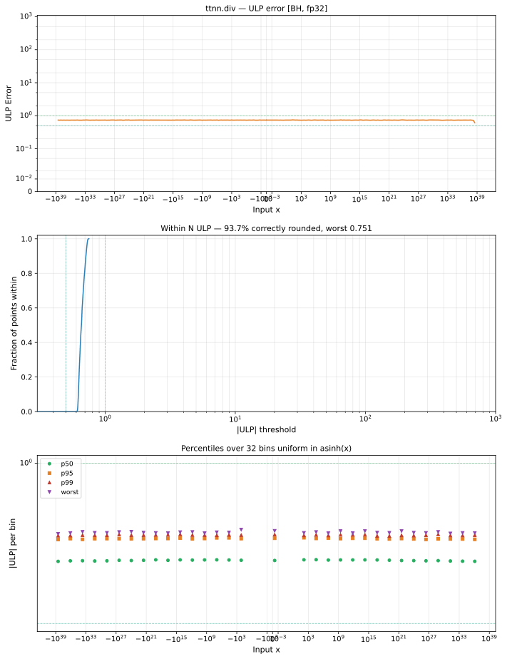

# div — Blackhole (BH), float32
_This page is auto-generated by `ttnn-accuracy report`. Do not edit manually._

**Architecture:** Blackhole (BH)  
**Data type:** float32  

---

[← Blackhole (BH) float32 ops](README.md) | [All archs for div](../../../by_op/div/README.md) | [Top](../../../README.md)

**Measured input range:** all normal values  

|  | `default` |
|---|---|
| Max ULP | 0.751 |
| Min ULP | 0.602 |
| Mean ULP | 0.662 |
| Signed bias (ULP) | -0.000218 |
| p50 ULP | 0.657 |
| p95 ULP | 0.722 |
| p99 ULP | 0.733 |
| Exact fraction | 0 |
| Correctly rounded | 0.937 |
| Max abs error | 1.49e+31 |
| Max rel error | 4.92e-08 |
| Median rel error | 4.02e-08 |
| Bits of precision (worst) | 24.3 |
| Bits of precision (median) | 24.6 |

**default** — faithful; 65024/65024 tie-breaks  

**Outcomes**

| Parameters | faithful |
|---|---|
| `default` | 65,024 |

**Worst points**

| Parameters | x | x2 | golden | device | ULP |
|---|---|---|---|---|---|
| `default` | -7.262626e-15 | -4.400833e-22 | 16502843 | 16502842 | 0.751 |
| `default` | 4.4585795e-19 | -1.1537636e-16 | -0.003864379 | -0.0038643787 | 0.748 |
| `default` | -9.36762e-10 | 8.163949e-28 | -1.1474374e+18 | -1.14743735e+18 | 0.747 |
| `default` | -2.1652626e-22 | -4.400833e-22 | 0.492012 | 0.49201196 | 0.747 |
| `default` | 16.037014 | 1.0169965e-31 | 1.5768997e+32 | 1.5768996e+32 | 0.747 |
| `default` | 1.1266726e+15 | 1.593393e+29 | 7.0709023e-15 | 7.0709027e-15 | 0.746 |
| `default` | 6.341552e+23 | 2.489841e+21 | 254.69707 | 254.69705 | 0.746 |
| `default` | 1.385566e+11 | 8521381 | 16259.877 | 16259.876 | 0.746 |
| `default` | 1.8830837e-37 | 1.3968809e-17 | 1.3480632e-20 | 1.3480631e-20 | 0.746 |
| `default` | -1.6035052e-30 | -5.5924544e-20 | 2.8672656e-11 | 2.8672655e-11 | 0.746 |

### Special values

| Variant | x | device | golden |  |
|---|---|---|---|---|
| `default` | 0 | 0 | 0 | agree |
| `default` | -0 | 0 | -0 | **differ** |
| `default` | inf | inf | inf | agree |
| `default` | -inf | -inf | -inf | agree |
| `default` | nan | nan | nan | agree |
| `default` | 1.1754944e-38 | 1.1754944e-38 | 1.1754944e-38 | agree |
| `default` | -1.1754944e-38 | -1.1754944e-38 | -1.1754944e-38 | agree |

> **Sampled, not exhaustive.** For this op both operands take 65,536 of the 2³² fp32 values, drawn once from a fixed seed. The figures above are a lower bound on the error, and comparable between releases, but they are not a bound over the dtype.

_Measured on BLACKHOLE · tt-metal `d80d9482a41` · ttnn `0.81.1` · run `20261031T031625`_

