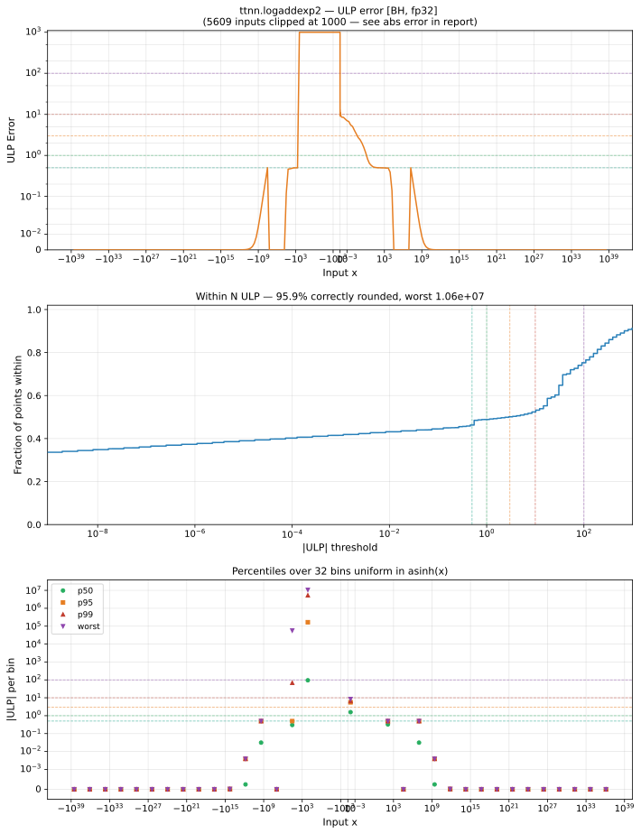

# logaddexp2 — Blackhole (BH), float32
_This page is auto-generated by `ttnn-accuracy report`. Do not edit manually._

**Architecture:** Blackhole (BH)  
**Data type:** float32  

---

[← Blackhole (BH) float32 ops](README.md) | [All archs for logaddexp2](../../../by_op/logaddexp2/README.md) | [Top](../../../README.md)

**Measured input range:** all normal values  

|  | `default` |
|---|---|
| Max ULP | 1.06e+07 ⚠ |
| Min ULP | 0 |
| Mean ULP | 1.23e+05 |
| Signed bias (ULP) | 1.22e+05 |
| p50 ULP | 2.57 |
| p95 ULP | 6.91e+03 |
| p99 ULP | 2.66e+06 |
| Exact fraction | 0.479 |
| Correctly rounded | 0.959 |
| Max abs error | 1 |
| Max rel error | 1.25 |
| Median rel error | 6.1e-06 |
| Bits of precision (worst) | -0.318 |
| Bits of precision (median) | 17.3 |

**default** — worst sampled pairing  

**Outcomes**

| Parameters | exact | faithful | inexact |
|---|---|---|---|
| `default` | 31,137 | 667 | 33,220 |

**Worst points**

| Parameters | x | x2 | golden | device | ULP |
|---|---|---|---|---|---|
| `default` | -2.6868502e-38 | -126.18573 | -1.1958257e-38 | -2.6868502e-38 | 1.06e+07 |
| `default` | -2.7119923e-38 | -126.18573 | -1.2209677e-38 | -2.7119923e-38 | 1.06e+07 |
| `default` | -2.7242585e-38 | -126.18573 | -1.2332339e-38 | -2.7242585e-38 | 1.06e+07 |
| `default` | -2.749063e-38 | -126.18573 | -1.2580385e-38 | -2.749063e-38 | 1.06e+07 |
| `default` | -2.7676687e-38 | -126.18573 | -1.2766441e-38 | -2.7676687e-38 | 1.06e+07 |
| `default` | -2.7865184e-38 | -126.18573 | -1.2954938e-38 | -2.7865184e-38 | 1.06e+07 |
| `default` | -2.8056492e-38 | -126.18573 | -1.3146247e-38 | -2.8056492e-38 | 1.06e+07 |
| `default` | -2.821648e-38 | -126.18573 | -1.3306233e-38 | -2.821648e-38 | 1.06e+07 |
| `default` | -2.830527e-38 | -126.18573 | -1.3395025e-38 | -2.830527e-38 | 1.06e+07 |
| `default` | -2.864667e-38 | -126.18573 | -1.3736423e-38 | -2.864667e-38 | 1.06e+07 |

### Special values

| Variant | x | device | golden |  |
|---|---|---|---|---|
| `default` | 0 | 1.5849625 | 1.5849625 | agree |
| `default` | -0 | 1.5849625 | 1.5849625 | agree |
| `default` | inf | inf | inf | agree |
| `default` | -inf | 1 | 1 | agree |
| `default` | nan | nan | nan | agree |
| `default` | 1.1754944e-38 | 1.5849625 | 1.5849625 | agree |
| `default` | -1.1754944e-38 | 1.5849625 | 1.5849625 | agree |

> **Sampled, not exhaustive.** For this op both operands take 65,536 of the 2³² fp32 values, drawn once from a fixed seed. The figures above are a lower bound on the error, and comparable between releases, but they are not a bound over the dtype.

_Measured on BLACKHOLE · tt-metal `d80d9482a41` · ttnn `0.81.1` · run `20261031T031625`_

