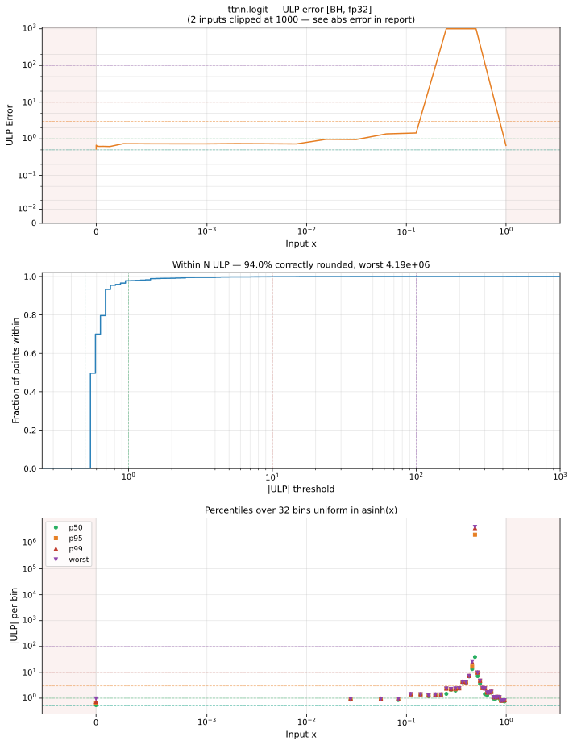

# logit — Blackhole (BH), float32
_This page is auto-generated by `ttnn-accuracy report`. Do not edit manually._

**Architecture:** Blackhole (BH)  
**Data type:** float32  

---

[← Blackhole (BH) float32 ops](README.md) | [All archs for logit](../../../by_op/logit/README.md) | [Top](../../../README.md)

**Measured input range:** x ∈ [min\_normal, 1]  

|  | `default` |
|---|---|
| Max ULP | 4.19e+06 ⚠ |
| Min ULP | 0.502 |
| Mean ULP | 261 |
| Signed bias (ULP) | -259 |
| p50 ULP | 0.544 |
| p95 ULP | 0.722 |
| p99 ULP | 1.65 |
| Exact fraction | 0 |
| Correctly rounded | 0.94 |
| Accurate to \|x\| | 0.266 |
| Max abs error | 4.53e-06 |
| Max rel error | 0.5 |
| Median rel error | 5.08e-08 |
| Bits of precision (worst) | 1 |
| Bits of precision (median) | 24.2 |

**default** — accurate to |x| <= 0.266  

**Outcomes**

| Parameters | faithful | inexact |
|---|---|---|
| `default` | 15,778 | 350 |

**Worst points**

| Parameters | x | golden | device | ULP |
|---|---|---|---|---|
| `default` | 0.49999997 | -1.1920929e-07 | -5.9604645e-08 | 4.19e+06 |
| `default` | 0.5000863 | 0.0003452301 | 0.00034517053 | 2.05e+03 |
| `default` | 0.4970561 | -0.011775749 | -0.011775652 | 104 |
| `default` | 0.49482575 | -0.020697737 | -0.020697834 | 52.3 |
| `default` | 0.4932243 | -0.027104488 | -0.027104585 | 52.2 |
| `default` | 0.5051953 | 0.020782027 | 0.0207821 | 39.5 |
| `default` | 0.48458746 | -0.061669696 | -0.061669793 | 26.4 |
| `default` | 0.48658398 | -0.053676974 | -0.05367707 | 26.4 |
| `default` | 0.4903653 | -0.038543586 | -0.038543683 | 26.3 |
| `default` | 0.48950425 | -0.041989177 | -0.041989274 | 26.3 |

**Monotonicity**

_Checked only where the reference is itself ordered, and never across a discontinuity._

| Parameters | Pairs | Violations | Rate | Worst \|Δy\| |
|---|---|---|---|---|
| `default` | 16,127 | 0 | 0 | 0 |

### Special values

| Variant | x | device | golden |  |
|---|---|---|---|---|
| `default` | 0 | -inf | -inf | agree |
| `default` | -0 | -inf | -inf | agree |
| `default` | inf | nan | nan | agree |
| `default` | -inf | nan | nan | agree |
| `default` | nan | nan | nan | agree |
| `default` | 1.1754944e-38 | -87.33655 | -87.33655 | agree |
| `default` | -1.1754944e-38 | nan | nan | agree |

_Measured on BLACKHOLE · tt-metal `d80d9482a41` · ttnn `0.81.1` · run `20261031T031810`_

