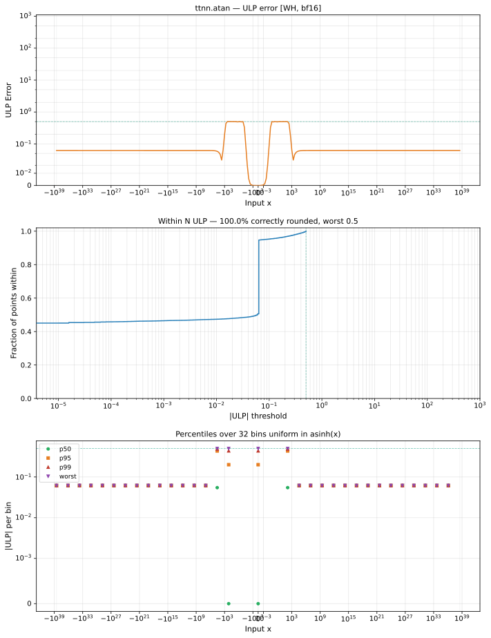

# atan — Wormhole (WH), bfloat16
_This page is auto-generated by `ttnn-accuracy report`. Do not edit manually._

**Architecture:** Wormhole (WH)  
**Data type:** bfloat16  

---

[← Wormhole (WH) bfloat16 ops](README.md) | [All archs for atan](../../../by_op/atan/README.md) | [Top](../../../README.md)

**Measured input range:** x ∈ [-3.39e+38, 3.39e+38]  

|  | `default` |
|---|---|
| Max ULP | 0.5 |
| Min ULP | 0 |
| Mean ULP | 0 |
| Signed bias (ULP) | 0 |
| p50 ULP | 0.0575 |
| p95 ULP | 0.0783 |
| p99 ULP | 0.409 |
| Exact fraction | 1 |
| Correctly rounded | 1 |
| Accurate to \|x\| | 3.39e+38 |
| Max abs error | 0.0039 |
| Max rel error | 0.00373 |
| Median rel error | 0 |
| Bits of precision (worst) | 8.07 |
| Bits of precision (median) | — |

**default** — bit-exact  

**Outcomes**

| Parameters | exact |
|---|---|
| `default` | 65,024 |

**Worst points**

| Parameters | x | golden | device | ULP |
|---|---|---|---|---|
| `default` | 23 | 1.53125 | 1.53125 | 0.5 |
| `default` | -23 | -1.53125 | -1.53125 | 0.5 |
| `default` | 228 | 1.5703125 | 1.5703125 | 0.499 |
| `default` | -228 | -1.5703125 | -1.5703125 | 0.499 |
| `default` | 0.09033203 | 0.08984375 | 0.08984375 | 0.499 |
| `default` | -0.09033203 | -0.08984375 | -0.08984375 | 0.499 |
| `default` | 82 | 1.5625 | 1.5625 | 0.499 |
| `default` | -82 | -1.5625 | -1.5625 | 0.499 |
| `default` | 0.4453125 | 0.41992188 | 0.41992188 | 0.498 |
| `default` | -0.4453125 | -0.41992188 | -0.41992188 | 0.498 |

**Monotonicity**

_Checked only where the reference is itself ordered, and never across a discontinuity._

| Parameters | Pairs | Violations | Rate | Worst \|Δy\| |
|---|---|---|---|---|
| `default` | 65,022 | 0 | 0 | 0 |

### Special values

| Variant | x | device | golden |  |
|---|---|---|---|---|
| `default` | 0 | 0 | 0 | agree |
| `default` | -0 | 0 | -0 | **differ** |
| `default` | inf | 1.5703125 | 1.5703125 | agree |
| `default` | -inf | -1.5703125 | -1.5703125 | agree |
| `default` | nan | inf | nan | **differ** |
| `default` | 1.1754944e-38 | 1.1754944e-38 | 1.1754944e-38 | agree |
| `default` | -1.1754944e-38 | -1.1754944e-38 | -1.1754944e-38 | agree |

_Measured on WORMHOLE_B0 · tt-metal `bfc3f70fd49` · ttnn `0.82.0` · run `20261128T024433`_

