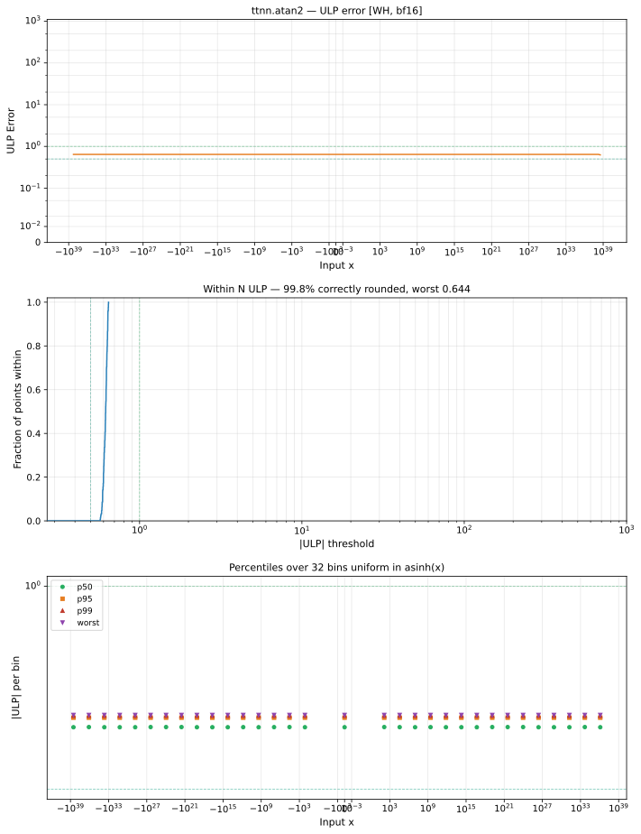

# atan2 — Wormhole (WH), bfloat16
_This page is auto-generated by `ttnn-accuracy report`. Do not edit manually._

**Architecture:** Wormhole (WH)  
**Data type:** bfloat16  

---

[← Wormhole (WH) bfloat16 ops](README.md) | [All archs for atan2](../../../by_op/atan2/README.md) | [Top](../../../README.md)

**Measured input range:** all normal values  

|  | `default` |
|---|---|
| Max ULP | 0.644 |
| Min ULP | 0.204 |
| Mean ULP | 0.615 |
| Signed bias (ULP) | 0 |
| p50 ULP | 0.618 |
| p95 ULP | 0.638 |
| p99 ULP | 0.643 |
| Exact fraction | 3.08e-05 |
| Correctly rounded | 0.998 |
| Max abs error | 0.00318 |
| Max rel error | 0.0035 |
| Median rel error | 0.00296 |
| Bits of precision (worst) | 8.16 |
| Bits of precision (median) | 8.4 |

**default** — faithful; 65024/65026 tie-breaks  

**Outcomes**

| Parameters | exact | faithful |
|---|---|---|
| `default` | 2 | 65,024 |

**Worst points**

| Parameters | x | x2 | golden | device | ULP |
|---|---|---|---|---|---|
| `default` | 1.8091593e-38 | 1.5887541e-38 | 0.8515625 | 0.84765625 | 0.644 |
| `default` | 3.6183185e-38 | 3.1775082e-38 | 0.8515625 | 0.84765625 | 0.644 |
| `default` | 7.236637e-38 | 6.3550163e-38 | 0.8515625 | 0.84765625 | 0.644 |
| `default` | 1.4473274e-37 | 1.2710033e-37 | 0.8515625 | 0.84765625 | 0.644 |
| `default` | 2.8946548e-37 | 2.5420065e-37 | 0.8515625 | 0.84765625 | 0.644 |
| `default` | 5.7893097e-37 | 5.084013e-37 | 0.8515625 | 0.84765625 | 0.644 |
| `default` | 1.1578619e-36 | 1.0168026e-36 | 0.8515625 | 0.84765625 | 0.644 |
| `default` | 2.3157239e-36 | 2.0336052e-36 | 0.8515625 | 0.84765625 | 0.644 |
| `default` | 4.6314477e-36 | 4.0672105e-36 | 0.8515625 | 0.84765625 | 0.644 |
| `default` | 9.2628955e-36 | 8.134421e-36 | 0.8515625 | 0.84765625 | 0.644 |

### Special values

| Variant | x | device | golden |  |
|---|---|---|---|---|
| `default` | 0 | 0 | 0 | agree |
| `default` | -0 | 0 | -0 | **differ** |
| `default` | inf | 1.5703125 | 1.5703125 | agree |
| `default` | -inf | -1.5703125 | -1.5703125 | agree |
| `default` | nan | inf | nan | **differ** |
| `default` | 1.1754944e-38 | 0 | 1.1754944e-38 | **differ** |
| `default` | -1.1754944e-38 | 0 | -1.1754944e-38 | **differ** |

> **Provenance unknown.** These figures predate run tracking. Re-measure to attribute them.

