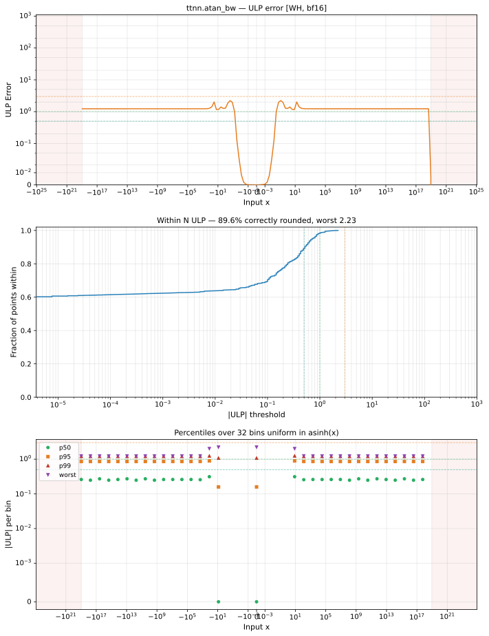

# atan_bw — Wormhole (WH), bfloat16
_This page is auto-generated by `ttnn-accuracy report`. Do not edit manually._

**Architecture:** Wormhole (WH)  
**Data type:** bfloat16  

---

[← Wormhole (WH) bfloat16 ops](README.md) | [All archs for atan_bw](../../../by_op/atan_bw/README.md) | [Top](../../../README.md)

**Measured input range:** x ∈ [-9.223e+18, 9.223e+18]  

|  | `default` |
|---|---|
| Max ULP | 2.23 |
| Min ULP | 0 |
| Mean ULP | 0.767 |
| Signed bias (ULP) | -0.0518 |
| p50 ULP | 0 |
| p95 ULP | 0.701 |
| p99 ULP | 1.2 |
| Exact fraction | 0.896 |
| Correctly rounded | 0.896 |
| Accurate to \|x\| | 0.23 |
| Max abs error | 0.00869 |
| Max rel error | 0.00917 |
| Median rel error | 0.00387 |
| Bits of precision (worst) | 6.77 |
| Bits of precision (median) | 8.01 |

**default** — accurate to |x| <= 0.23  

**Outcomes**

| Parameters | exact | faithful | inexact |
|---|---|---|---|
| `default` | 43,344 | 4,306 | 736 |

**Worst points**

| Parameters | x | golden | device | ULP |
|---|---|---|---|---|
| `default` | 0.23339844 | 0.94921875 | 0.95703125 | 2.23 |
| `default` | -0.23339844 | 0.94921875 | 0.95703125 | 2.23 |
| `default` | 0.23242188 | 0.94921875 | 0.95703125 | 2.12 |
| `default` | -0.23242188 | 0.94921875 | 0.95703125 | 2.12 |
| `default` | 0.23144531 | 0.94921875 | 0.95703125 | 2.02 |
| `default` | -0.23144531 | 0.94921875 | 0.95703125 | 2.02 |
| `default` | 17 | 0.0034484863 | 0.003479004 | 2.01 |
| `default` | -17 | 0.0034484863 | 0.003479004 | 2.01 |
| `default` | 0.087890625 | 0.9921875 | 1 | 1.96 |
| `default` | -0.087890625 | 0.9921875 | 1 | 1.96 |

**Monotonicity**

_Checked only where the reference is itself ordered, and never across a discontinuity._

| Parameters | Pairs | Violations | Rate | Worst \|Δy\| |
|---|---|---|---|---|
| `default` | 48,384 | 0 | 0 | 0 |

### Special values

| Variant | x | device | golden |  |
|---|---|---|---|---|
| `default` | 0 | 1 | 1 | agree |
| `default` | -0 | 1 | 1 | agree |
| `default` | inf | 0 | 0 | agree |
| `default` | -inf | 0 | 0 | agree |
| `default` | nan | 0 | nan | **differ** |
| `default` | 1.1754944e-38 | 1 | 1 | agree |
| `default` | -1.1754944e-38 | 1 | 1 | agree |

_Measured on WORMHOLE_B0 · tt-metal `d80d9482a41` · ttnn `0.81.1` · run `20261031T024224`_

