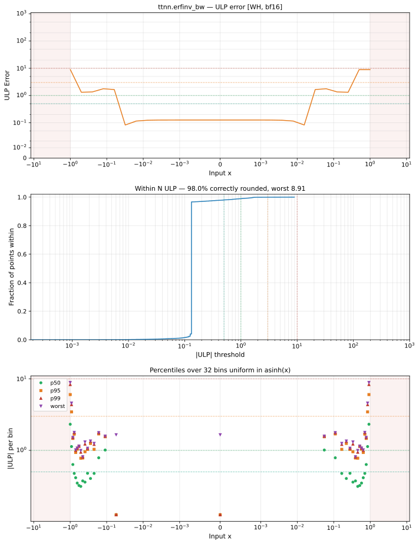

# erfinv_bw — Wormhole (WH), bfloat16
_This page is auto-generated by `ttnn-accuracy report`. Do not edit manually._

**Architecture:** Wormhole (WH)  
**Data type:** bfloat16  

---

[← Wormhole (WH) bfloat16 ops](README.md) | [All archs for erfinv_bw](../../../by_op/erfinv_bw/README.md) | [Top](../../../README.md)

**Measured input range:** x ∈ [-0.9961, 0.9961]  

|  | `default` |
|---|---|
| Max ULP | 8.91 |
| Min ULP | 0.000366 |
| Mean ULP | 1.2 |
| Signed bias (ULP) | -0.281 |
| p50 ULP | 0.126 |
| p95 ULP | 0.126 |
| p99 ULP | 1.02 |
| Exact fraction | 0.98 |
| Correctly rounded | 0.98 |
| Accurate to \|x\| | 0.859 |
| Max abs error | 2.23 |
| Max rel error | 0.0391 |
| Median rel error | 0.00501 |
| Bits of precision (worst) | 4.68 |
| Bits of precision (median) | 7.64 |

**default** — accurate to |x| <= 0.859  

**Outcomes**

| Parameters | exact | faithful | inexact |
|---|---|---|---|
| `default` | 31,622 | 298 | 336 |

**Worst points**

| Parameters | x | golden | device | ULP |
|---|---|---|---|---|
| `default` | 0.99609375 | 57 | 54.75 | 8.91 |
| `default` | -0.99609375 | 57 | 54.75 | 8.91 |
| `default` | 0.98828125 | 21.25 | 20.5 | 5.89 |
| `default` | -0.98828125 | 21.25 | 20.5 | 5.89 |
| `default` | 0.9921875 | 30.5 | 29.875 | 4.87 |
| `default` | -0.9921875 | 30.5 | 29.875 | 4.87 |
| `default` | 0.90234375 | 3.5 | 3.421875 | 4.59 |
| `default` | -0.90234375 | 3.5 | 3.421875 | 4.59 |
| `default` | 0.9609375 | 7.4375 | 7.3125 | 4.42 |
| `default` | -0.9609375 | 7.4375 | 7.3125 | 4.42 |

**Monotonicity**

_Checked only where the reference is itself ordered, and never across a discontinuity._

| Parameters | Pairs | Violations | Rate | Worst \|Δy\| |
|---|---|---|---|---|
| `default` | 32,254 | 0 | 0 | 0 |

### Special values

| Variant | x | device | golden |  |
|---|---|---|---|---|
| `default` | 0 | 0.88671875 | 0.88671875 | agree |
| `default` | -0 | 0.88671875 | 0.88671875 | agree |
| `default` | inf | inf | nan | **differ** |
| `default` | -inf | inf | nan | **differ** |
| `default` | nan | inf | nan | **differ** |
| `default` | 1.1754944e-38 | 0.88671875 | 0.88671875 | agree |
| `default` | -1.1754944e-38 | 0.88671875 | 0.88671875 | agree |

_Measured on WORMHOLE_B0 · tt-metal `978f93b56e3` · ttnn `0.80.0` · run `20261017T025120`_

