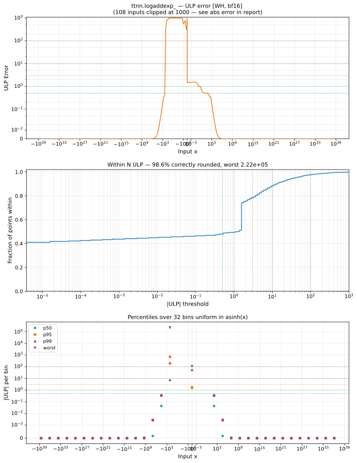

# logaddexp_ — Wormhole (WH), bfloat16
_This page is auto-generated by `ttnn-accuracy report`. Do not edit manually._

**Architecture:** Wormhole (WH)  
**Data type:** bfloat16  

---

[← Wormhole (WH) bfloat16 ops](README.md) | [All archs for logaddexp_](../../../by_op/logaddexp_/README.md) | [Top](../../../README.md)

**Measured input range:** all normal values  

|  | `default` |
|---|---|
| Max ULP | 2.22e+05 ⚠ |
| Min ULP | 0 |
| Mean ULP | 44.7 |
| Signed bias (ULP) | -15 |
| p50 ULP | 1.17 |
| p95 ULP | 36.5 |
| p99 ULP | 255 |
| Exact fraction | 0.485 |
| Correctly rounded | 0.986 |
| Max abs error | 1 |
| Max rel error | 1.65e+03 |
| Median rel error | 0.00736 |
| Bits of precision (worst) | -10.7 |
| Bits of precision (median) | 7.09 |

**default** — worst sampled pairing  

**Outcomes**

| Parameters | exact | faithful | inexact | overflow |
|---|---|---|---|---|
| `default` | 31,559 | 726 | 32,740 | 1 |

**Worst points**

| Parameters | x | x2 | golden | device | ULP |
|---|---|---|---|---|---|
| `default` | -0.41992188 | -1.0703125 | -5.029142e-07 | 0.0008277893 | 2.22e+05 |
| `default` | -1.0703125 | -0.41992188 | -5.029142e-07 | 0.0008277893 | 2.22e+05 |
| `default` | -0.045654297 | -3.109375 | 1.0207295e-06 | 0.00017261505 | 2.3e+04 |
| `default` | -3.109375 | -0.045654297 | 1.0207295e-06 | 0.00017261505 | 2.3e+04 |
| `default` | -0.052734375 | -2.96875 | -5.6251884e-07 | 6.914139e-05 | 1.87e+04 |
| `default` | -2.96875 | -0.052734375 | -5.6251884e-07 | 6.914139e-05 | 1.87e+04 |
| `default` | -0.57421875 | -0.828125 | 1.2278557e-05 | 0.0010910034 | 1.81e+04 |
| `default` | -0.828125 | -0.57421875 | 1.2278557e-05 | 0.0010910034 | 1.81e+04 |
| `default` | -0.4453125 | -1.0234375 | -1.847744e-05 | -0.001739502 | 1.44e+04 |
| `default` | -1.0234375 | -0.4453125 | -1.847744e-05 | -0.001739502 | 1.44e+04 |

**Non-finite outputs**

| Parameters | Points | Both | Device only | Golden only | Device inf | Device nan | Golden inf | Golden nan |
|---|---|---|---|---|---|---|---|---|
| `default` | 1 | 1 | 0 | 0 | 1 | 0 | 1 | 0 |

| Parameters | x | x2 | golden | device |
|---|---|---|---|---|
| `default` | inf | 0 | inf | inf |

### Special values

| Variant | x | device | golden |  |
|---|---|---|---|---|
| `default` | 0 | 1.3125 | 1.3125 | agree |
| `default` | -0 | 1.3125 | 1.3125 | agree |
| `default` | inf | inf | inf | agree |
| `default` | -inf | 1 | 1 | agree |
| `default` | nan | inf | nan | **differ** |
| `default` | 1.1754944e-38 | 1.3125 | 1.3125 | agree |
| `default` | -1.1754944e-38 | 1.3125 | 1.3125 | agree |

_Measured on WORMHOLE_B0 · tt-metal `d80d9482a41` · ttnn `0.81.1` · run `20261031T024218`_

