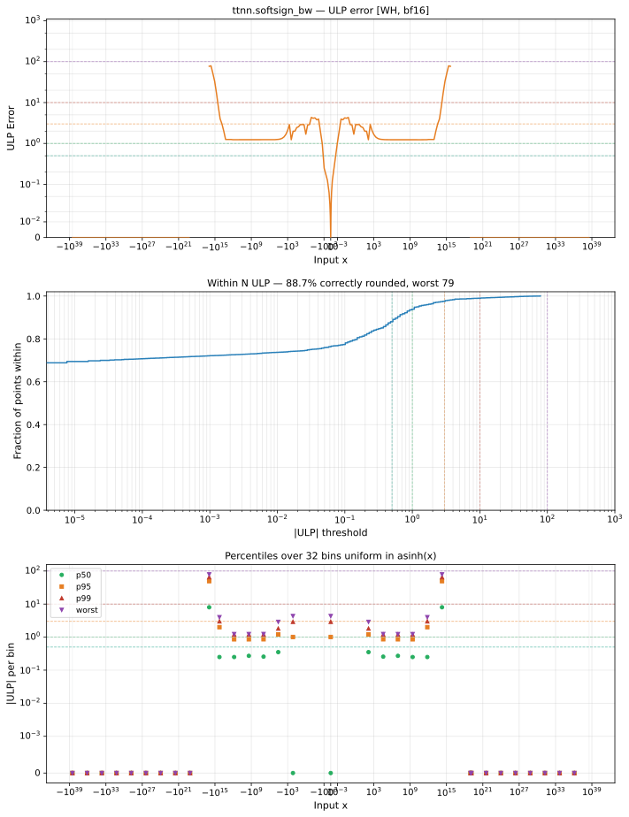

# softsign_bw — Wormhole (WH), bfloat16
_This page is auto-generated by `ttnn-accuracy report`. Do not edit manually._

**Architecture:** Wormhole (WH)  
**Data type:** bfloat16  

---

[← Wormhole (WH) bfloat16 ops](README.md) | [All archs for softsign_bw](../../../by_op/softsign_bw/README.md) | [Top](../../../README.md)

**Measured input range:** x ∈ [-3.39e+38, 3.39e+38]  

|  | `default` |
|---|---|
| Max ULP | 79 |
| Min ULP | 0 |
| Mean ULP | 3.74 |
| Signed bias (ULP) | -0.349 |
| p50 ULP | 0 |
| p95 ULP | 1.17 |
| p99 ULP | 9.5 |
| Exact fraction | 0.885 |
| Correctly rounded | 0.887 |
| Accurate to \|x\| | 0.00391 |
| Max abs error | 0.0169 |
| Max rel error | 0.617 |
| Median rel error | 0.0052 |
| Bits of precision (worst) | 0.696 |
| Bits of precision (median) | 7.59 |

**default** — accurate to |x| <= 0.00391  

**Outcomes**

| Parameters | exact | faithful | inexact |
|---|---|---|---|
| `default` | 55,236 | 3,360 | 6,428 |

**Worst points**

| Parameters | x | golden | device | ULP |
|---|---|---|---|---|
| `default` | 3.5360294e+15 | 4.9303807e-32 | 7.97335e-32 | 79 |
| `default` | -3.5360294e+15 | 4.9303807e-32 | 7.97335e-32 | 79 |
| `default` | 5.031365e+15 | 2.4651903e-32 | 3.9481564e-32 | 77 |
| `default` | -5.031365e+15 | 2.4651903e-32 | 3.9481564e-32 | 77 |
| `default` | 3.3249232e+15 | 1.4791142e-31 | 9.013352e-32 | 75 |
| `default` | -3.3249232e+15 | 1.4791142e-31 | 9.013352e-32 | 75 |
| `default` | 3.6063981e+15 | 4.9303807e-32 | 7.70372e-32 | 72 |
| `default` | -3.6063981e+15 | 4.9303807e-32 | 7.70372e-32 | 72 |
| `default` | 3.6239903e+15 | 4.9303807e-32 | 7.588164e-32 | 69 |
| `default` | -3.6239903e+15 | 4.9303807e-32 | 7.588164e-32 | 69 |

### Special values

| Variant | x | device | golden |  |
|---|---|---|---|---|
| `default` | 0 | 1 | 1 | agree |
| `default` | -0 | 1 | 1 | agree |
| `default` | inf | 0 | nan | **differ** |
| `default` | -inf | 0 | nan | **differ** |
| `default` | nan | 0 | nan | **differ** |
| `default` | 1.1754944e-38 | 1 | 1 | agree |
| `default` | -1.1754944e-38 | 1 | 1 | agree |

_Measured on WORMHOLE_B0 · tt-metal `978f93b56e3` · ttnn `0.80.0` · run `20261024T025247`_

