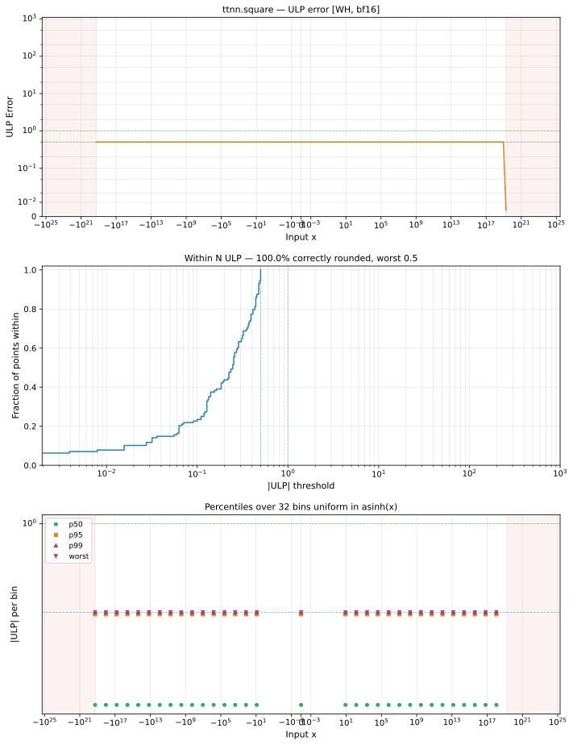

# square — Wormhole (WH), bfloat16
_This page is auto-generated by `ttnn-accuracy report`. Do not edit manually._

**Architecture:** Wormhole (WH)  
**Data type:** bfloat16  

---

[← Wormhole (WH) bfloat16 ops](README.md) | [All archs for square](../../../by_op/square/README.md) | [Top](../../../README.md)

**Measured input range:** x ∈ [-1.837e+19, 1.837e+19]  

|  | `default` |
|---|---|
| Max ULP | 0.5 |
| Min ULP | 0 |
| Mean ULP | 0 |
| Signed bias (ULP) | 0 |
| p50 ULP | 0.242 |
| p95 ULP | 0.492 |
| p99 ULP | 0.5 |
| Exact fraction | 1 |
| Correctly rounded | 1 |
| Accurate to \|x\| | 1.84e+19 |
| Max abs error | 6.59e+35 |
| Max rel error | 0.00348 |
| Median rel error | 0 |
| Bits of precision (worst) | 8.17 |
| Bits of precision (median) | — |

**default** — bit-exact  

**Outcomes**

| Parameters | exact | flushed |
|---|---|---|
| `default` | 32,512 | 16,128 |

**Worst points**

| Parameters | x | golden | device | ULP |
|---|---|---|---|---|
| `default` | 1.1519648e-19 | 1.3224311e-38 | 1.3224311e-38 | 0.5 |
| `default` | 1.2874901e-19 | 1.653039e-38 | 1.653039e-38 | 0.5 |
| `default` | 1.4230154e-19 | 2.0203809e-38 | 2.0203809e-38 | 0.5 |
| `default` | 2.3039296e-19 | 5.2897246e-38 | 5.2897246e-38 | 0.5 |
| `default` | 2.5749802e-19 | 6.612156e-38 | 6.612156e-38 | 0.5 |
| `default` | 2.8460307e-19 | 8.0815237e-38 | 8.0815237e-38 | 0.5 |
| `default` | 4.607859e-19 | 2.1158898e-37 | 2.1158898e-37 | 0.5 |
| `default` | 5.1499603e-19 | 2.6448623e-37 | 2.6448623e-37 | 0.5 |
| `default` | 5.6920614e-19 | 3.2326095e-37 | 3.2326095e-37 | 0.5 |
| `default` | 9.215718e-19 | 8.463559e-37 | 8.463559e-37 | 0.5 |

**Monotonicity**

_Checked only where the reference is itself ordered, and never across a discontinuity._

| Parameters | Pairs | Violations | Rate | Worst \|Δy\| |
|---|---|---|---|---|
| `default` | 32,510 | 0 | 0 | 0 |

### Special values

| Variant | x | device | golden |  |
|---|---|---|---|---|
| `default` | 0 | 0 | 0 | agree |
| `default` | -0 | 0 | 0 | agree |
| `default` | inf | inf | inf | agree |
| `default` | -inf | inf | inf | agree |
| `default` | nan | inf | nan | **differ** |
| `default` | 1.1754944e-38 | 0 | 0 | agree |
| `default` | -1.1754944e-38 | 0 | 0 | agree |

_Measured on WORMHOLE_B0 · tt-metal `d80d9482a41` · ttnn `0.81.1` · run `20261031T024432`_

