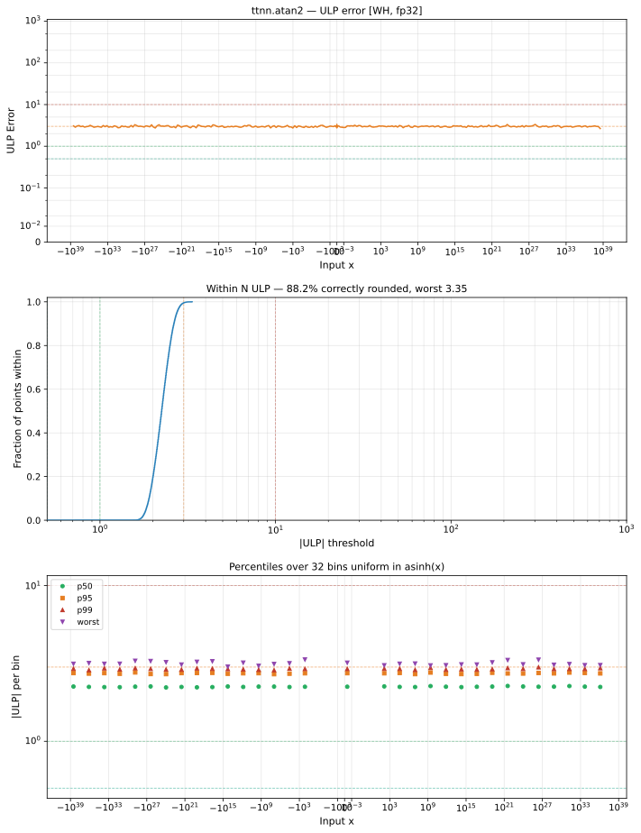

# atan2 — Wormhole (WH), float32
_This page is auto-generated by `ttnn-accuracy report`. Do not edit manually._

**Architecture:** Wormhole (WH)  
**Data type:** float32  

---

[← Wormhole (WH) float32 ops](README.md) | [All archs for atan2](../../../by_op/atan2/README.md) | [Top](../../../README.md)

**Measured input range:** all normal values  

|  | `default` |
|---|---|
| Max ULP | 3.35 |
| Min ULP | 1.49 |
| Mean ULP | 2.26 |
| Signed bias (ULP) | -0.00453 |
| p50 ULP | 2.24 |
| p95 ULP | 2.74 |
| p99 ULP | 2.92 |
| Exact fraction | 0 |
| Correctly rounded | 0.882 |
| Max abs error | 2e-07 |
| Max rel error | 2.51e-07 |
| Median rel error | 1.64e-07 |
| Bits of precision (worst) | 21.9 |
| Bits of precision (median) | 22.5 |

**default** — worst sampled pairing  

**Outcomes**

| Parameters | inexact |
|---|---|
| `default` | 65,024 |

**Worst points**

| Parameters | x | x2 | golden | device | ULP |
|---|---|---|---|---|---|
| `default` | -1.4811946e-21 | 1.4515539e-21 | -0.7955046 | -0.7955048 | 3.35 |
| `default` | 1.7095257e+28 | 1.6716385e+28 | 0.7966031 | 0.79660326 | 3.34 |
| `default` | 5.4985266e+23 | 5.416381e+23 | 0.79292405 | 0.7929242 | 3.33 |
| `default` | -3.5770269e+28 | 3.5054445e+28 | -0.7955048 | -0.795505 | 3.29 |
| `default` | -4.02351e-38 | 3.9671998e-38 | -0.792445 | -0.7924452 | 3.28 |
| `default` | -4.2116004e+24 | 4.1403893e+24 | -0.7939242 | -0.7939244 | 3.28 |
| `default` | -4.6644234e+25 | 4.578958e+25 | -0.79464406 | -0.79464424 | 3.28 |
| `default` | -7.8343097e+15 | 7.6804307e+15 | -0.7953161 | -0.7953163 | 3.26 |
| `default` | -9.003404e-38 | 8.813037e-38 | -0.7960827 | -0.79608285 | 3.25 |
| `default` | -2.0867808e+18 | 2.0496224e+18 | -0.7943812 | -0.7943814 | 3.24 |

### Special values

| Variant | x | device | golden |  |
|---|---|---|---|---|
| `default` | 0 | 0 | 0 | agree |
| `default` | -0 | -0 | -0 | agree |
| `default` | inf | 1.5707964 | 1.5707964 | agree |
| `default` | -inf | -1.5707964 | -1.5707964 | agree |
| `default` | nan | nan | nan | agree |
| `default` | 1.1754944e-38 | 1.1754944e-38 | 1.1754944e-38 | agree |
| `default` | -1.1754944e-38 | -1.1754944e-38 | -1.1754944e-38 | agree |

> **Sampled, not exhaustive.** For this op both operands take 65,536 of the 2³² fp32 values, drawn once from a fixed seed. The figures above are a lower bound on the error, and comparable between releases, but they are not a bound over the dtype.

> **Provenance unknown.** These figures predate run tracking. Re-measure to attribute them.

