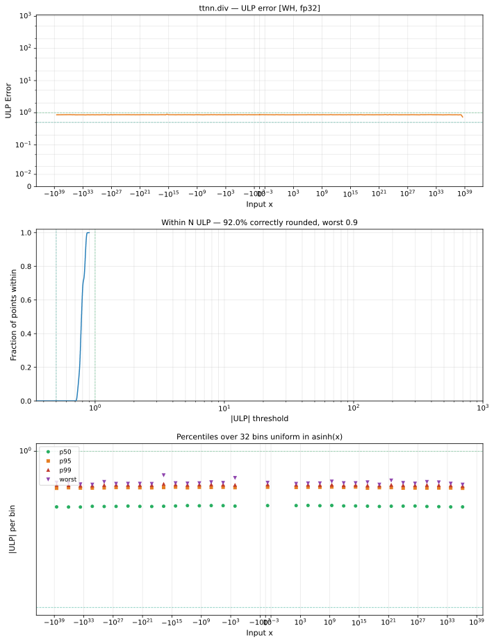

# div — Wormhole (WH), float32
_This page is auto-generated by `ttnn-accuracy report`. Do not edit manually._

**Architecture:** Wormhole (WH)  
**Data type:** float32  

---

[← Wormhole (WH) float32 ops](README.md) | [All archs for div](../../../by_op/div/README.md) | [Top](../../../README.md)

**Measured input range:** all normal values  

|  | `default` |
|---|---|
| Max ULP | 0.9 |
| Min ULP | 0.702 |
| Mean ULP | 0.789 |
| Signed bias (ULP) | 0.00214 |
| p50 ULP | 0.784 |
| p95 ULP | 0.851 |
| p99 ULP | 0.861 |
| Exact fraction | 0 |
| Correctly rounded | 0.92 |
| Max abs error | 1.75e+31 |
| Max rel error | 6.26e-08 |
| Median rel error | 5.18e-08 |
| Bits of precision (worst) | 23.9 |
| Bits of precision (median) | 24.2 |

**default** — faithful; 65024/65024 tie-breaks  

**Outcomes**

| Parameters | faithful |
|---|---|
| `default` | 65,024 |

**Worst points**

| Parameters | x | x2 | golden | device | ULP |
|---|---|---|---|---|---|
| `default` | -1.1264428e+15 | -3.0242947e+23 | 3.7246464e-09 | 3.7246461e-09 | 0.9 |
| `default` | -3.3091334e-24 | -2.3298385e-10 | 1.4203274e-14 | 1.4203273e-14 | 0.889 |
| `default` | -1.3235338e-23 | -2.3298385e-10 | 5.6807962e-14 | 5.680796e-14 | 0.886 |
| `default` | 4.551348e-13 | -7.530445e-37 | -6.0439294e+23 | -6.043929e+23 | 0.88 |
| `default` | 1.5138832e+23 | -1.4595748e-11 | -1.0372084e+34 | -1.0372083e+34 | 0.88 |
| `default` | 9.404985e-38 | 1.6985597e-21 | 5.5370355e-17 | 5.5370352e-17 | 0.878 |
| `default` | 1.2334694e-32 | -3.6427094e-12 | -3.3861319e-21 | -3.3861317e-21 | 0.877 |
| `default` | 1.890113e+22 | -3.6427094e-12 | -5.188756e+33 | -5.1887557e+33 | 0.877 |
| `default` | 6.874187e+10 | 2.1217415e-22 | 3.2398798e+32 | 3.2398796e+32 | 0.875 |
| `default` | -6.191009e+26 | -3.0242947e+23 | 2047.0919 | 2047.0918 | 0.874 |

### Special values

| Variant | x | device | golden |  |
|---|---|---|---|---|
| `default` | 0 | 0 | 0 | agree |
| `default` | -0 | 0 | -0 | **differ** |
| `default` | inf | inf | inf | agree |
| `default` | -inf | -inf | -inf | agree |
| `default` | nan | nan | nan | agree |
| `default` | 1.1754944e-38 | 1.1754944e-38 | 1.1754944e-38 | agree |
| `default` | -1.1754944e-38 | -1.1754944e-38 | -1.1754944e-38 | agree |

> **Sampled, not exhaustive.** For this op both operands take 65,536 of the 2³² fp32 values, drawn once from a fixed seed. The figures above are a lower bound on the error, and comparable between releases, but they are not a bound over the dtype.

_Measured on WORMHOLE_B0 · tt-metal `d80d9482a41` · ttnn `0.81.1` · run `20261031T024218`_

