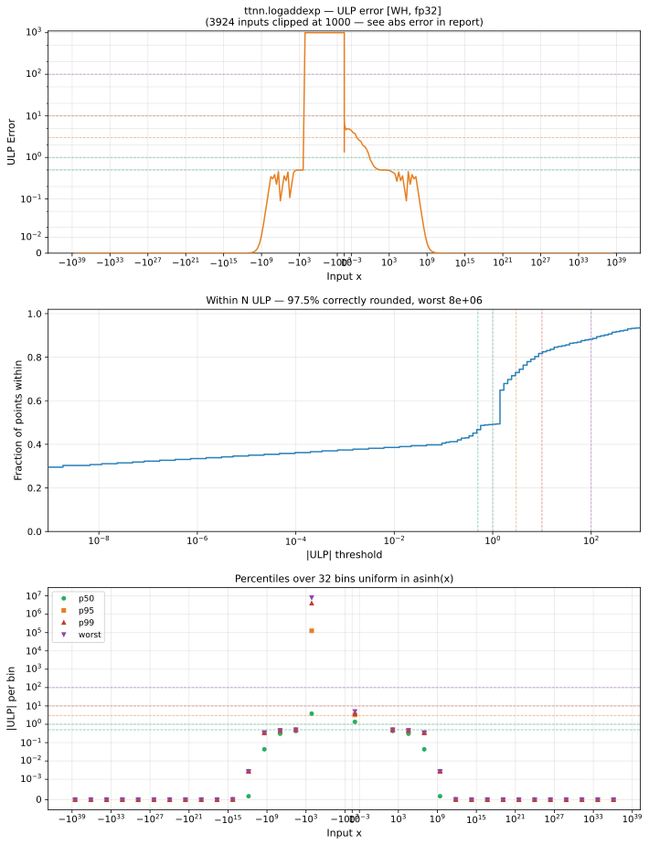

# logaddexp — Wormhole (WH), float32
_This page is auto-generated by `ttnn-accuracy report`. Do not edit manually._

**Architecture:** Wormhole (WH)  
**Data type:** float32  

---

[← Wormhole (WH) float32 ops](README.md) | [All archs for logaddexp](../../../by_op/logaddexp/README.md) | [Top](../../../README.md)

**Measured input range:** all normal values  

|  | `default` |
|---|---|
| Max ULP | 8e+06 ⚠ |
| Min ULP | 0 |
| Mean ULP | 9.77e+04 |
| Signed bias (ULP) | 9.76e+04 |
| p50 ULP | 1.35 |
| p95 ULP | 3.57e+03 |
| p99 ULP | 2e+06 |
| Exact fraction | 0.483 |
| Correctly rounded | 0.975 |
| Max abs error | 1 |
| Max rel error | 0.947 |
| Median rel error | 2.51e-07 |
| Bits of precision (worst) | 0.078 |
| Bits of precision (median) | 21.9 |

**default** — worst sampled pairing  

**Outcomes**

| Parameters | exact | faithful | inexact |
|---|---|---|---|
| `default` | 31,386 | 621 | 33,017 |

**Worst points**

| Parameters | x | x2 | golden | device | ULP |
|---|---|---|---|---|---|
| `default` | 1.1837498e-38 | -87.384346 | 2.3043759e-38 | 1.1837498e-38 | 8e+06 |
| `default` | 1.187421e-38 | -87.384346 | 2.308047e-38 | 1.187421e-38 | 8e+06 |
| `default` | 1.2021456e-38 | -87.384346 | 2.3227717e-38 | 1.2021456e-38 | 8e+06 |
| `default` | 1.2092162e-38 | -87.384346 | 2.3298423e-38 | 1.2092162e-38 | 8e+06 |
| `default` | 1.2204055e-38 | -87.384346 | 2.3410316e-38 | 1.2204055e-38 | 8e+06 |
| `default` | 1.2232443e-38 | -87.384346 | 2.3438704e-38 | 1.2232443e-38 | 8e+06 |
| `default` | -2.3035186e-38 | -87.384346 | -1.1828925e-38 | -2.3035186e-38 | 8e+06 |
| `default` | -2.3124998e-38 | -87.384346 | -1.1918737e-38 | -2.3124998e-38 | 8e+06 |
| `default` | -2.320685e-38 | -87.384346 | -1.200059e-38 | -2.320685e-38 | 8e+06 |
| `default` | -2.3281213e-38 | -87.384346 | -1.2074952e-38 | -2.3281213e-38 | 8e+06 |

### Special values

| Variant | x | device | golden |  |
|---|---|---|---|---|
| `default` | 0 | 1.3132617 | 1.3132616 | **differ** |
| `default` | -0 | 1.3132617 | 1.3132616 | **differ** |
| `default` | inf | inf | inf | agree |
| `default` | -inf | 1 | 1 | agree |
| `default` | nan | nan | nan | agree |
| `default` | 1.1754944e-38 | 1.3132617 | 1.3132616 | **differ** |
| `default` | -1.1754944e-38 | 1.3132617 | 1.3132616 | **differ** |

> **Sampled, not exhaustive.** For this op both operands take 65,536 of the 2³² fp32 values, drawn once from a fixed seed. The figures above are a lower bound on the error, and comparable between releases, but they are not a bound over the dtype.

> **Provenance unknown.** These figures predate run tracking. Re-measure to attribute them.

