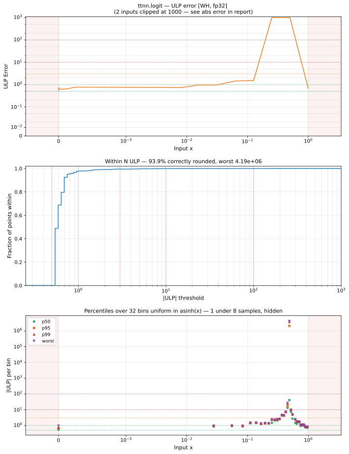

# logit — Wormhole (WH), float32
_This page is auto-generated by `ttnn-accuracy report`. Do not edit manually._

**Architecture:** Wormhole (WH)  
**Data type:** float32  

---

[← Wormhole (WH) float32 ops](README.md) | [All archs for logit](../../../by_op/logit/README.md) | [Top](../../../README.md)

**Measured input range:** x ∈ [min\_normal, 1]  

|  | `default` |
|---|---|
| Max ULP | 4.19e+06 ⚠ |
| Min ULP | 0.502 |
| Mean ULP | 261 |
| Signed bias (ULP) | -259 |
| p50 ULP | 0.545 |
| p95 ULP | 0.74 |
| p99 ULP | 1.7 |
| Exact fraction | 0 |
| Correctly rounded | 0.939 |
| Accurate to \|x\| | 0.266 |
| Max abs error | 4.53e-06 |
| Max rel error | 0.5 |
| Median rel error | 5.1e-08 |
| Bits of precision (worst) | 1 |
| Bits of precision (median) | 24.2 |

**default** — accurate to |x| <= 0.266  

**Outcomes**

| Parameters | faithful | inexact |
|---|---|---|
| `default` | 15,777 | 351 |

**Worst points**

| Parameters | x | golden | device | ULP |
|---|---|---|---|---|
| `default` | 0.49999997 | -1.1920929e-07 | -5.9604645e-08 | 4.19e+06 |
| `default` | 0.5000998 | 0.0003991127 | 0.00039903307 | 2.74e+03 |
| `default` | 0.49804547 | -0.007818143 | -0.007818247 | 112 |
| `default` | 0.49609032 | -0.015639028 | -0.01563913 | 54.9 |
| `default` | 0.4939634 | -0.024147611 | -0.024147712 | 54.1 |
| `default` | 0.50398386 | 0.015935758 | 0.015935682 | 41 |
| `default` | 0.4914563 | -0.034178127 | -0.034178227 | 27 |
| `default` | 0.48796204 | -0.048161156 | -0.048161257 | 26.7 |
| `default` | 0.48880854 | -0.044773307 | -0.044773407 | 26.6 |
| `default` | 0.48525777 | -0.058985997 | -0.058986098 | 26.6 |

**Monotonicity**

_Checked only where the reference is itself ordered, and never across a discontinuity._

| Parameters | Pairs | Violations | Rate | Worst \|Δy\| |
|---|---|---|---|---|
| `default` | 16,127 | 0 | 0 | 0 |

### Special values

| Variant | x | device | golden |  |
|---|---|---|---|---|
| `default` | 0 | -inf | -inf | agree |
| `default` | -0 | -inf | -inf | agree |
| `default` | inf | nan | nan | agree |
| `default` | -inf | nan | nan | agree |
| `default` | nan | nan | nan | agree |
| `default` | 1.1754944e-38 | -87.33655 | -87.33655 | agree |
| `default` | -1.1754944e-38 | nan | nan | agree |

> **Provenance unknown.** These figures predate run tracking. Re-measure to attribute them.

